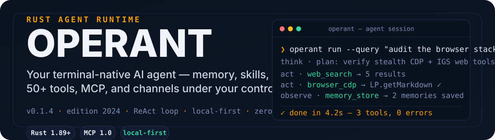

# Operant

## On this page

- [Quick start](#quick-start)
- [What it is](#what-it-is)
- [How the agent loop works](#how-the-agent-loop-works)
- [Features](#features)
- [Skills](#skills)
- [Configuring operant](#configuring-operant)
- [CLI reference](#cli-reference)
- [Build prerequisites](#build-prerequisites)
- [Development](#development)
- [Licensing](#licensing)

**Your terminal-native AI agent.** Persistent memory, 70+ JSON-schema tools, skills, MCP, and messaging channels — built in Rust, run from your shell, and fully under your control.



---

## Quick start

```bash
git clone https://github.com/ishan-parihar/operant.git && cd operant

./scripts/install.sh          # release build → /usr/local/bin/operant
# or: scripts/build.sh --release

operant setup                 # interactive wizard: provider, memory, TTS, gateway
operant chat                  # start chatting (TUI)
```

One-shot runs need no TUI at all:

```bash
operant run --query "Audit the browser stack: check the sourcehound web tools and the CDP browser"
```

---

## What it is

Operant is a production-grade **ReAct agent runtime** written in Rust. It replaces the "script per task" pattern with one agent that can **think, use tools, and remember** — over a long-lived terminal session or in scriptable one-shot runs.

Why it is different:

- **A real agentic loop, not a chat wrapper** — think → act → observe with a JSON-schema tool registry, automatic memory-context injection, provider fallbacks, and self-healing retries.
- **Memory that stays in-process** — the default `memory-wire` provider is an embedded engine (hybrid BM25 + token-overlap search) called directly over its sync `retain`/`recall` API: no server to spawn, no port to wait on, and a `catch_unwind` boundary that turns a panic into a memory miss instead of a dead turn. Context is prefetched before every turn and written back after it.
- **Skills you can point at a directory** — import an entire skill tree (with recursive security scan), bundle multiple skills, autoload at boot, and let the agent curate new ones.
- **Only enabled, functional tools reach the model** — the registry serves the intersection of *registered ∩ available ∩ not-disabled*, so the agent never sees tools that can't run.
- **One stealth browser for everything** — the `sourcehound` binary serves both the web tools (`web_search` / `web_scrape` / `web_extract` / `web_crawl`) and the browser (`cloakctl.navigate` / `read` / `act`) over its own MCP server on stdio. No API keys; if the binary is missing, every web tool degrades to a helpful error.
- **Local-first** — no telemetry, no account required; bring any OpenAI-compatible endpoint or a local model.
- **Persistent Kernel (opt-in)** — a stateful Python kernel whose variables survive across turns, a continual-harness store (session-local + global prompt/subagent lessons with snapshot rollback), and a tool bridge that lets one kernel cell call allowlisted tools in a loop (RLM-lite). See [docs/kernel.md](docs/kernel.md). Disabled by default; `git submodule update --init --recursive` + `[tools.kernel] enabled = true` to adopt.

---

## How the agent loop works

The agent loop is a classic ReAct cycle, executed with bounded iterations and tool timeouts:

```
 user ──▶ model ──▶ act (tool registry) ──▶ observe ──▶ next step
              ▲                                │
              └──────── memory context ◀───────┘
```

- **Registry** — every tool exposes a runtime JSON schema; `get_schemas()` feeds exactly what is enabled.
- **Memory** — pre-turn `prefetch()` injects `<memory_context>`; post-turn `queue_prefetch()` warms the provider; compression hooks fire on long sessions.
- **Resilience** — fallback model chains, rate-limit buckets with exponential backoff, and tool call healing (`max_healing_attempts`).

### Crate map

```
operant
├── crates/
│   ├── operant-core         agent loop · tool registry · memory provider · config
│   ├── operant-cli          TUI (ratatui) · commands · app adapter
│   ├── operant-tools        built-in tool implementations
│   ├── operant-providers    LLM provider adapters
│   ├── operant-memory       memory backends (memory-wire — the one engine)
│   ├── operant-plugins      WASM plugin bridge
│   ├── operant-config       config schema · validation · defaults
│   ├── operant-harness      unified harness (persistence seam + config)
│   └── …                    api · infra · macros (12 crates total —
│                           the 6 crates the binary never called were
│                           deleted in the 2026-10-17 purge)
```

---

## Features

| Capability | Implementation |
|---|---|
| **Memory** | `memory-wire` in-process hybrid semantic memory (BM25 + token-overlap), panic-guarded — the one engine (legacy `MEMORY.md`/`USER.md` import once on upgrade) |
| **Tools** | 70+ JSON-schema tools: fs, git, web (sourcehound search/scrape/extract/crawl), browser (CDP), shell, code, http, memory, skills, cron, kanban, process, notes, checkpoints |
| **Browser** | Stealth **sourcehound** — the engine's own profile cookie jar and DevTools endpoint, driven over MCP and shared with the web tools |
| **Skills** | Directory import with recursive security scan · bundles · autoload · curator |
| **Models** | Any OpenAI-compatible endpoint (`base_url`), local llama.cpp, Ollama; fallback chains + token-bucket rate limiting |
| **MCP** | Native client (stdio + HTTP, deferred loading) **and** server (`operant mcp serve` — stdio: `initialize` → `tools/list` → `tools/call`); reconnect materializes tools mid-session |
| **Channels** | Telegram · Discord · Slack · WhatsApp · email · SMS · webhooks via the gateway (7 platforms) |
| **Autonomy** | `operant autonomous` — a self-directed dev loop over `TODO.md` with test-command guardrails |
| **Org governance** | Per-employee permission scoping — seat policies (`yolo`/`standard`/`scoped`/`lockdown`) with deny/allow globs, a TTL'd grant ledger, durable escalation queue (unattended cron runs ask-and-deny; a senior's `/approve` mints a grant), reporting lines, and one attributable worklog row per scheduled run |
| **Plugins** | WASM plugin tools · **Hooks** — a lifecycle hook registry (`agent_start`, `agent_end`, `turn_start`, `turn_end`) plus the operator's own shell commands (`operant hooks add --event agent_end -- <cmd>`) |
| **Interface** | ratatui TUI · interactive chat · scriptable `run` · one-shot `test` |

---

## Skills

Skills are **markdown instruction packs** — the same mechanism hermes-agent uses — that the agent loads and injects into its context on demand. They teach operant *how to do* things (debugging protocols, git workflows, security methodology) so it behaves like an experienced operator rather than a generic model. Invoke one in the TUI with `/skill <name>`; the agent can also call the `skill` tool itself mid-loop.

**SOPs** are the operator's own playbooks for recurring tasks: TOML files in `~/.operant/sops/` (`operant sop list` shows them). The agent reaches them through the `sop` tool — list the playbooks, read one — so a procedure you wrote down is one the harness can actually follow.

### Directory layout

Operant ships a **categorized** pool in the repo, and installs it **flat** into the user skills directory (matching `operant skills seed`):

```
repo:                                 installed (user):
skills/                               ~/.operant/skills/
├── devops/  github/  mcp/            ├── cli/
├── productivity/  research/         ├── docker-management/
├── security/  software-development/ ├── systematic-debugging/
├── workspace-lint/                   ├── test-driven-development/
├── autonomous-ai-agents/  apple/     ├── …
├── creative/  email/  media/        └── <107 skills in the repo pool>
├── mlops/  note-taking/
├── smart-home/  social-media/
```

Each skill is a directory containing a `SKILL.md` (required) plus any reference files, scripts, and templates:

```
~/.operant/skills/systematic-debugging/
├── SKILL.md          # frontmatter + instructions (injected verbatim)
└── …                 # optional references/ scripts/ examples/
```

### SKILL.md frontmatter

```yaml
---
name: systematic-debugging        # slug used by /skill <name> and the skill tool
description: "4-phase root cause debugging."  # one-line summary for the model
author: Operant                  # provenance
license: MIT
platforms: [linux, macos, windows]
version: 1.1.0
metadata:
  operant:
    tags: [debugging, root-cause]       # used by the curator & search
    related_skills: [plan, tdd]         # auto-suggested companions
---
```

### Seeding (fresh installs are agent-ready from scratch)

| Path | What it does |
|---|---|
| `./scripts/install.sh` | Builds the binary **and** seeds `~/.operant/skills` from the repo pool (offline, idempotent) |
| First run | If the skills dir is empty, the binary auto-seeds from the bundled pool (`OPERANT_BUNDLED_SKILLS_DIR` override, then `<repo>/skills`, then `<exe>/../skills`) |
| `operant skills seed [--source DIR] [--force]` | Manual re-seed; `--force` overwrites local edits |

Location overrides (the binary honors these too):

```bash
export HERMES_HOME=~/.operant          # home root (skills default under it)
export HERMES_SKILLS_DIR=/custom/skills # exact skills dir (config [skills] root_dir)
export OPERANT_BUNDLED_SKILLS_DIR=/path/to/pool  # where seeding reads from
```

### Managing skills

```bash
operant skills list          # installed skills (+ /name for the TUI)
operant skills install ./foo # import a skill dir or URL (recursive security scan)
operant skills bundle        # combine skills into one
operant skills audit         # scan for unsafe patterns (skills_guard)
operant curator              # agent-curated skill lifecycle (archive/backup/restore)
```

---

## Configuring operant

Config lives at `~/.operant/operant.toml` (secrets in `~/.operant/.env`). Start from the annotated reference:

```bash
cp operant.example.toml ~/.operant/operant.toml
operant doctor        # validate config + dependencies
operant status        # system overview
```

Highlights:

```toml
[client]              # any OpenAI-compatible endpoint
base_url = "https://api.openai.com/v1"

[agent]
model = "gpt-4"
fallback_models = ["gpt-4o-mini"]   # tried in order when the primary fails
max_iterations = 20
show_reasoning = true # TUI: thinking stays until your next prompt; /thinking-display full|current|off

[memory]
provider = "memory-wire"      # the only engine; other names warn + are ignored

[browser]
provider = "sourcehound"      # the only browser engine; other names warn + are ignored

[skills]
autoload = true
```

See [`operant.example.toml`](operant.example.toml) for the full reference — every section is annotated.

### What wins: environment, `.env`, or `operant.toml`

1. **Process environment** — `OPENAI_BASE_URL`, `HERMES_MODEL` and the `OPERANT_*` aliases override the file on every load. `operant config show` lists every key that came from the environment and the loader warns once per key, so an export left over from another tool cannot win silently.
2. **`~/.operant/.env`** — credential pins written by `/connect`, re-read before every gateway turn and TUI turn. A project-local `.env` is read only when the home file is absent; when both exist the loader warns once, naming the file it ignores.
3. **`~/.operant/operant.toml`** — the file everything else falls back to.

Two traps worth knowing: `~/.operant/config.toml` is read by no binary path (the loader warns when it sits beside `operant.toml`), and **proxy environment variables (`HTTP(S)_PROXY`, `ALL_PROXY`) never redirect provider traffic**.

One switch worth knowing: operant checks GitHub once per session for a newer `aft`/`sourcehound` build, in the background. `OPERANT_NO_AUTO_UPDATE=1` turns that off — set it on a machine that must not reach GitHub on its own.

### Terminal scrollback mode (opt-in)

```toml
[tui]
terminal_scroll_mode = true
```

Renders in your terminal's main buffer with a small live region at the bottom instead of the alternate screen, so the **terminal owns the history**:

- **Scroll** with the wheel, `Shift+PgUp` / `Shift+PgDn`, or tmux copy-mode (`prefix` + `[`).
- **Select and copy** with the terminal's own selection — Operant never captures the mouse in this mode, so drag-select, double-click and your terminal's copy shortcut work across the whole session.
- Full-screen views (`/rewind`, settings, pickers) still take the alternate screen while open and hand the scrollback back when closed.
- Default is off (alt-screen app mode, with in-app mouse scroll/selection) until the live terminal sweep (tmux, kitty, ghostty, alacritty) is signed off.

---

## CLI reference

| Command | What it does |
|---|---|
| `operant` / `operant chat` | Interactive chat (TUI) |
| `operant run --query "…"` | One-shot run (scriptable, `--record-trajectory` for replay) |
| `operant autonomous` | Self-directed development loop |
| `operant setup` | Interactive setup wizard |
| `operant tools list` | Inspect the enabled tool registry |
| `operant skills list / install / audit` | Skill management (install a directory or URL) |
| `operant mcp list / add / test / serve` | MCP servers; `serve` runs Operant as an MCP server over stdio; `/mcp r` in the TUI reconnects deferred servers |
| `operant memory query / export` | Search / export memory |
| `operant sessions list` | Session history |
| `operant model get / set` | Active model configuration |
| `operant cron` / `operant kanban` | Scheduled jobs / task boards |
| `operant gateway start` | Messaging gateway (telegram, discord, slack, whatsapp) |
| `operant plugins list` | WASM plugins |
| `operant doctor` / `operant status` | Health checks and system overview |
| `operant update integrations` | Force-check sourcehound/aft updates (auto: first use per session, 6h throttle) |
| `operant debug memory` | This process's memory footprint: RSS, store size, thread count |

`operant --help` lists the full set (sessions, checkpoints, profiles, auth, completion, backups, SOPs, and more).

---

## Build prerequisites

- **Rust 1.89+** (edition 2024)
- 4 GB RAM (8 GB recommended)
- A model: any OpenAI-compatible endpoint, or a local llama.cpp / Ollama server
- Optional: the `sourcehound` binary, for the web tools and the stealth browser (no API key; omit it and those tools report a clear error)

---

## Development

This repo is developed in a strict **iteration model**: one change = one
iteration = one commit pushed to `origin/main`, labeled `<type>(iter-N)`.
Read [`AGENTS.md`](AGENTS.md) top-to-bottom before your first change — it is
the single source of truth for the protocol (iteration numbering, parallel-agent
coordination, deploy procedure).

```bash
source scripts/dev-env.sh           # libclang / ONNX Runtime / bindgen env

# Scope every check to the crate you touched — a full workspace build is 10+ min:
./scripts/check.sh check -p operant-core --lib
cargo test -p operant-core --lib -- <filter>

cargo fmt --all
bash scripts/clippy-warning-gate.sh  # incremental gate: fails only on NEW warnings

# Final verification before push (slow):
./scripts/check.sh check --workspace
./scripts/check.sh test  --workspace
./scripts/self-test.sh               # full pre-push sweep
```

Development conventions enforced by the gate: no `.unwrap()`/`.expect()` in
production code (justified sites carry `#[expect(..., reason)]`), typed errors
in library crates (`thiserror`-style; `anyhow` only in binaries), and scoped
compilation to keep iteration cycles fast.

The GitHub Actions quota for this repo is exhausted, so **the local loop is the
gate** — no workflow runs on a push or a tag. The commands above are what
verifies a change; `scripts/self-test.sh` runs the whole sweep.

Work is planned in dated docs (`docs/plan-YYYY-MM-DD-*.md`) with executed rows
marked in place, and every user-visible change lands in
[`docs/CHANGELOG.md`](docs/CHANGELOG.md) in the same iteration.

Architecture, porting notes, and parity decisions live in [`AGENTS.md`](AGENTS.md) and [`docs/`](docs/) (audits, BUGS, CHANGELOG, TODO). Which document owns which question is [`docs/INDEX.md`](docs/INDEX.md); the map of the one-off audit and design pages is [`docs/PAGE-INDEX.md`](docs/PAGE-INDEX.md). The open defect ledger is [`docs/audit/2026-06-19-BUGS.md`](docs/audit/2026-06-19-BUGS.md) (the old root `BUGS.md` is [`docs/BUGS.md`](docs/BUGS.md), now a tombstone), and the implementation-gap inventories are [`docs/REMAINING-GAPS.md`](docs/REMAINING-GAPS.md) and [`docs/agentic-os/REMAINING-GAPS.md`](docs/agentic-os/REMAINING-GAPS.md).

---

## Licensing

MIT **or** Apache-2.0 — see [LICENSE-MIT](LICENSE-MIT) or [LICENSE-APACHE](LICENSE-APACHE).

Contributing: [docs/CONTRIBUTING.md](docs/CONTRIBUTING.md) · Security: [docs/SECURITY.md](docs/SECURITY.md) · Conduct: [docs/CODE_OF_CONDUCT.md](docs/CODE_OF_CONDUCT.md) · Attribution: [docs/ATTRIBUTION.md](docs/ATTRIBUTION.md)

---

## ☕ Support & Sponsorship

If you find this project useful, consider supporting ongoing development:

[](https://github.com/sponsors/ishan-parihar)
[](https://rzp.io/rzp/ishan-parihar)

Your support funds new features, releases, and infrastructure for the whole ecosystem.