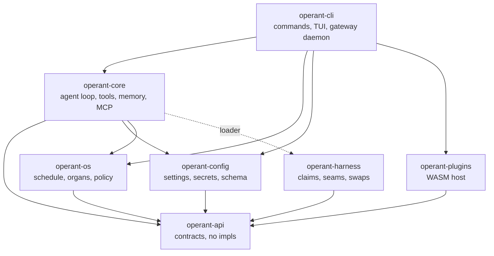

# Outline — operant

The shape of the system, in the order a reader needs it. The generated FACTS
(language, size, gate, dependencies, wiring edges) live in the `stack` zone of
`AGENTS.md`; this page holds what a generator cannot: the one rule that shaped
the design, why the parts are separated the way they are, and the order to read
them in.

Owns: the whole-system shape — the crate boundaries, the reason each exists, and
the read order.
Not for: any single mechanism (that is `docs/library/`), the rules of working
here (`AGENTS.md`), where the project stands today
(`docs/handoff/STATE.md`), or the measured facts (the `AGENTS.md#stack` zone).

## The one paragraph

Operant is a runtime for AI agents that have to do real work on a real machine.
It holds the model client, the tool registry, the memory, the schedule, the
permissions and the transcript in one process, so an agent can be pointed at a
job and left to run: it decides, acts, sees the result, and records what it did.
Everything an agent can DO passes through one registry with one approval gate;
everything it can KNOW passes through one memory engine; everything it says
lands in one transcript.

## The shape



| Crate | Lines (Rust) | What it is | Why it is its own crate |
|---|---|---|---|
| `operant-api` | 3,403 | The contracts every other crate agrees on: tool, provider, session, memory, channel, VAD, schema traits. No implementations, no heavy dependencies. | The compiler stops one part importing another directly, so the boundaries hold under pressure instead of only in the design document. |
| `operant-core` | 244,960 | The product: the agent loop (`agent/`), the tool registry and every builtin (`tools/`), memory, MCP client + server, context management, the channel adapters (`gateway/`), the org layer, the database. | This is where the product lives, and it changes more than anything else here. |
| `operant-cli` | 245,335 | Every command a human types (`main.rs`, `cmd_*.rs`), the TUI (342 files under `tui/`), the gateway daemon, autonomous mode, the dashboard, the ACP server. | The interface changes fastest and breaks nobody when it does. |
| `operant-os` | 4,881 | The operating layer: the supervisor, the organs, the policy and enforcement contracts, the archive, the run environment. | Persistence and bookkeeping are a different concern from reasoning, and they fail differently. |
| `operant-harness` | 7,896 | How capabilities register themselves: claims, discovery, effects, swaps, composition-as-data, the WASM provider. | Extension is a mechanism with its own rules, and it is the part that has to stay stable while features move. |
| `operant-config` | 6,865 | The settings file's schema, the provider alias table, autonomy and policy sections, secret resolution. | Configuration is the only part of the system a non-developer touches, so it has its own tests and its own errors. |
| `operant-plugins` | 3,010 | WebAssembly extensions that add tools, skills and observers without a rebuild. | Plugin code runs untrusted, so it needs its own sandbox boundary and its own error types. |

Two vendored crates sit outside the workspace and are excluded from the build:
`vendor/ndarray-npy` and `vendor/kokoro-tiny` — pinned copies of things this
project needed at a specific version.

## The one rule

**Every capability crosses a seam, and every seam has an owner.** A tool is not
a function the model can call; it is an `OperantTool` in one registry, with one
schema generator, one guardrail ladder and one approval gate in front of it. The
same shape repeats at every scale: memory goes through `MemoryProvider`, models
through `ModelClient`, channels through the gateway's platform registry, skills
through `SkillManager`'s roots, plugins through the capability seams
(`Tool`/`Channel`/`Memory`/`Observer`/`Skill`).

That is why a security fix lands once instead of per-tool, why a provider swap
does not touch the loop, and why the documentation is organised the same way:
one library page per seam, each naming the modules that implement it.

## How the parts wire

- `operant-api` is the leaf. Nothing depends on it being small, so it stays
  small: a heavy dependency here would land in every crate.
- `operant-core` depends on `operant-api`, `operant-config` and `operant-os`.
  It is the only crate that knows about the agent loop.
- `operant-cli` depends on everything and is depended on by nothing. That is
  deliberate: the library crates must not know a terminal exists.
- `operant-harness` and `operant-plugins` are reached through `operant-core`'s
  plugin host (`crates/operant-core/src/plugins/`), never the reverse. A plugin
  cannot import the harness; the host hands it a capability slot.
- `operant-os` holds the schedule and the org organs, and is consumed by
  `operant-core`'s org layer (`crates/operant-core/src/org/`) — the Holon
  boundary described in [library/org.md](library/org.md).

## How to read it

1. `docs/ARCHITECTURE.md` — the same shape written for a non-reader of code.
2. `docs/library/README.md` — the mechanism library: one page per element.
3. The library group you came for: **agentic core** (loop, context, memory,
   providers, tools, delegation) → **capacities** (voice, vision, browser,
   web, kernel, harness) → **surfaces** (TUI, gateway, sessions, skills, MCP,
   plugins, autonomous, org) → **foundations** (config, security, persistence,
   observability, operability).
4. `docs/library/<page>.md`'s `Source:` header — the modules that implement it.

## How to check it

```bash
source scripts/dev-env.sh
./scripts/check.sh check -p operant-core --lib      # scoped, never --workspace mid-iteration
./scripts/genome lint                               # docs + ownership + coverage gates
```

`genome lint` green means: every doc is in the ownership map (E301), every
backticked path in a library page exists (E303), and every source file is named
by at least one library page (E311). That last one is the reverse of the first
and it is what makes the library's completeness a gate rather than a claim —
see [regressions/RG-022](regressions/RG-022-a-library-page-that-nothing-checks-is-coverage-nobody-has-th.md).