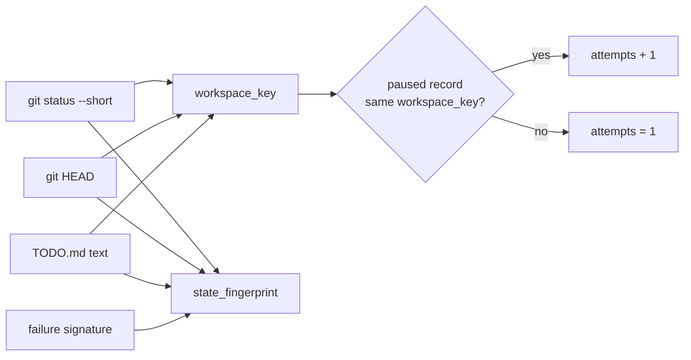
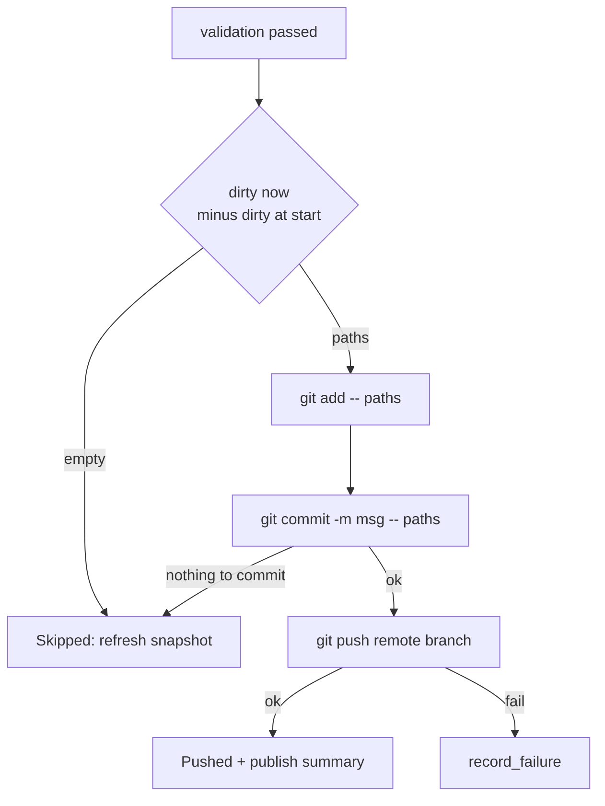

# Autonomous mode — the self-directed loop

Owns: autonomous coding mode — the TODO.md ledger loop, the workspace
snapshot gate, the repeated-failure pause, the publish path, and the
runtime state file.
Not for: the agent loop it drives
([agent-loop.md](agent-loop.md)), the global pause that halts scheduled
work ([verification.md](verification.md) §estop), the iteration protocol
human/AI agents follow (`AGENTS.md`), the org layer's seat policy
([org.md](org.md)).

Source: `crates/operant-cli/src/autonomous.rs` (the runner), launched by
`operant autonomous` or `operant run --autonomous`
(`crates/operant-cli/src/main.rs`), `TODO.md` (the ledger it drives),
`crates/operant-core/src/config.rs` (`[autonomous]` defaults).

## The loop

`run_autonomous(config, system_prompt)` takes the process CWD as the repo
root, builds a `RealAutonomousAgentExecutor` (holding the `AppConfig` and
the optional system prompt) and a `RealCommandExecutor`, and hands both to
`AutonomousRunner::run_loop`. The executor builds a FRESH `OperantAgent`
inside each tick, via `create_agent_without_events`, so every tick starts
from a clean agent with a fresh MCP manager and no carried-over
conversation; there is no warm agent reused between ticks.

The loop is a `tokio::time::interval` at
`autonomous.interval_secs` (default **300 s**) with
`MissedTickBehavior::Delay`, so a slow tick never fires a burst of
catch-up ticks. Every tick is `self.tick().await`; an error is logged
(`error!`) and the loop continues — the runner does not die on a failed
tick.

One tick, in order:

1. **Snapshot the workspace.** Read `TODO.md`; if it is missing, write
   `state = Idle` and return. Parse the ledger; if `## Pending` is empty,
   clear the failure record, write `state = Idle` and return.
2. **Pause check.** If the persisted failure record is `paused` and its
   `state_fingerprint` matches the current workspace, write `state =
   Paused` and return WITHOUT running the agent. If the record is paused
   but the fingerprint has moved, clear the record and continue.
3. **Build the prompt** (`build_autonomous_query`) from the snapshot:
   implemented items, pending items, full `TODO.md` text, branch, HEAD,
   `git status --short`, and the previous failure's signature + details
   when one exists. The prompt instructs the agent to work only the next
   realistically-achievable pending item, to update `TODO.md` by moving
   completed work from Pending to Implemented, and explicitly: **"do not
   run git add, git commit, or git push"** — publishing is the runner's
   job.
4. **Write `state = Running`**, then run the agent.
5. **Detect change.** If `git status --short` is byte-identical to the
   pre-run status, record a failure ("Agent produced no workspace
   changes.") and return.
6. **Re-snapshot** (TODO contents and statuses re-read; branch and HEAD
   kept from the pre-run snapshot).
7. **Validate.** Run `autonomous.test_command` (default
   `cargo test --workspace`) through the detected shell, bounded by
   `autonomous.command_timeout_secs` (default 900). A non-zero exit, or a
   timeout, records a failure with the command's own output tail.
8. **Publish** (below).
9. **Write `state = Succeeded`** with the validation and publish summaries.

## The ledger: TODO.md

`parse_todo_ledger` walks the file line by line. `## Implemented` and
`## Pending` (case-insensitive) open their sections; **any other `## `
heading closes the current section**, so `## Review` items are parsed into
neither list and can never reach the agent's queue. List markers
(`- [x]`, `- [X]`, `- [ ]`, bare `-`) are stripped and the text is
trimmed. The repo-root `TODO.md` is the default target
(`[autonomous] todo_path`); a relative path resolves against the repo
root, an absolute one is used as-is.

The ledger is the contract: the operator seeds `## Pending`, the loop
consumes it, and the agent is asked to move rows to `## Implemented` with
the iteration id. `crates/operant-cli/src/autonomous.rs`'s first test
parses the real repo-root `TODO.md` and asserts every pending row is
free of `/commit` — the Review rows must not leak into the work queue.

## The workspace snapshot and the two hashes

- `workspace_key` = hash of (todo contents, HEAD, worktree status). It
  answers "is this the same state I failed on?" — the attempt counter
  only increments while the key matches, so a fix that changes the tree
  starts a fresh count.
- `state_fingerprint` = the same three plus the failure signature. It
  answers "has anything at all moved since the pause?" — an edit to
  `TODO.md`, a new commit, or a different error all clear the pause.

## The repeated-failure pause

`record_failure` increments `attempts` (from the prior record when the
workspace key matches, else 1) and pauses when
`attempts >= autonomous.max_failures_per_state` (default **3**). The
state file is written with `state = Paused` and a warning naming the
status path.

A paused runner is **cheap, not inert**: it still snapshots, still writes
a `Paused` status row, and still returns without calling the agent. The
pause clears on the first tick whose fingerprint differs, and that tick
starts again at `attempts = 1`.

The state survives restarts because the runner reads
`autonomous-status.toml` at construction (`AutonomousRunner::new`) and
reconstructs the `FailureRecord` from it. A corrupt or unreadable status
file is a warning and a fresh runtime state — never a hard failure.

## The publish path

The staging scope is the load-bearing part (AD-027). The runner captures
`git status --short` BEFORE the tick and again after validation, and
stages only the **difference** — paths this tick made dirty. A file the
owner left dirty before the tick is never staged, never committed, and
stays dirty (regression test
`a_tick_does_not_commit_a_file_the_owner_left_dirty`). Both `git add` and
`git commit` name the paths explicitly after `--`, so even the commit
cannot sweep in anything else, including anything the owner staged by
hand. `status_paths` splits a rename's `old -> new` into both sides, so a
rename records the removal as well as the addition.

`PublishOutcome` is `Failed | Skipped(WorkspaceSnapshot) |
Pushed(WorkspaceSnapshot, StatusPublishSummary)`. A commit that reports
"nothing to commit" is treated as Skipped, not failed. A failed add,
commit or push records a failure whose signature is the command's own
first output line (or `"<prefix> timed out"`), and the status file
carries the validation summary and, when the push was the step that
failed, the publish summary too.

The status file itself is filtered out of the worktree status the runner
reads (`filter_status_output` matches the status path as a path SUFFIX,
not a substring), so the runner never sees its own state file as a
workspace change.

## `autonomous-status.toml`

Written atomically (temp file + rename, with a Windows-style
remove-then-rename fallback) after every state transition. Shape, all
optional and `#[serde(default)]`:

| field | meaning |
|---|---|
| `state` | `idle` / `running` / `failed` / `paused` / `succeeded` |
| `repo_root`, `todo_path`, `branch`, `head` | the snapshot identity |
| `implemented_items`, `pending_items` | the parsed ledger at tick time |
| `last_tick_started_unix_secs`, `last_tick_completed_unix_secs`, `last_success_unix_secs` | timing |
| `attempts`, `last_failure_signature`, `last_error`, `paused` | failure state |
| `workspace_key`, `state_fingerprint` | the two hashes, as decimal strings |
| `last_validation` | `{success, exit_code, stdout, stderr, timed_out}` |
| `last_publish` | `{remote, branch, commit_message}` |

## Configuration

| key | default | what it changes |
|---|---|---|
| `autonomous.interval_secs` | 300 | seconds between ticks |
| `autonomous.todo_path` | `"TODO.md"` | the ledger (relative → repo root) |
| `autonomous.status_path` | `"autonomous-status.toml"` | the state file (relative → repo root) |
| `autonomous.test_command` | `"cargo test --workspace"` | the validation command, run through the detected shell |
| `autonomous.command_timeout_secs` | 900 | per-command deadline for git and validation |
| `autonomous.git_remote` | `"origin"` | push remote |
| `autonomous.git_branch` | `"agent-dev"` | push target branch |
| `autonomous.commit_message` | `"Auto-commit by operant-rs"` | commit subject |
| `autonomous.max_failures_per_state` | 3 | attempts before the pause |

`git_remote` / `git_branch` are push TARGETS, not branches the runner
creates: the loop pushes the current work onto that remote branch whatever
branch the repo is on.

## Surfaces

- `operant autonomous [--system <PROMPT>]` — `Commands::Autonomous`,
  calls `autonomous::run_autonomous` directly.
- `operant run --autonomous` — the same entry point, with one guard: it
  **rejects `--query`** ("Autonomous mode reads TODO.md from the
  workspace."), because a query would contradict the ledger.
- `TODO.md` — the operator's queue, in the `## Implemented` / `## Pending`
  / `## Review` shape above.
- `autonomous-status.toml` — the operator's window into the loop's state;
  no CLI subcommand reads it back.

## Failure modes

- **TODO.md missing** → `state = Idle`, no agent call, next tick retries.
- **TODO.md has no pending rows** → `state = Idle`, failure record
  cleared, no agent call.
- **Agent produced no change** → failure "Agent produced no workspace
  changes." with the pre-run status in the report.
- **Validation fails / times out** → failure with the command's stdout
  and stderr in `last_validation`, and `last_error` names the exit code.
- **Publish step fails** → failure at that step (`git add failed`,
  `git commit failed`, `git push failed`), with the publish summary
  preserved when the push was the failure.
- **Pause engaged** → `state = Paused` on every subsequent tick until the
  workspace fingerprint moves. The status file says so; the loop keeps
  polling cheaply.
- **Corrupt status file** → warning, fresh runtime state. The loop does
  not refuse to start.

## Intention

Autonomous mode is the operator's delegation endpoint, and every design
choice follows from "the agent is not trusted to publish". The ledger is
the contract (the operator seeds it, the loop consumes it, and Review
rows are structurally excluded so an owner decision can never be worked
by accident). The snapshot gate is the honesty check: publish only what
the tick changed, never what the model claims. The two hashes exist
because a crash-looping task must not become a crash-looping machine, and
because a pause that never clears is as bad as one that never engages —
the fingerprint is what makes the pause resumable without operator
intervention. Nothing here is a git wrapper for the agent: the prompt
forbids git writes, and the runner owns `add`/`commit`/`push` end to end.
