# TUI rendering — from transcript state to cells

Owns: the render pipeline end to end — how `App` state becomes a
`DisplayMessage` vec, how a frame is prepared and cached, how a body is
wrapped, how markdown and mermaid become `ratatui` lines, how the
viewport resolves scroll and anchors, how a frame is painted and
post-processed, and what the adapter types and the two hub dialogs
contribute.

Not for: the module layering, the event loop, the slash-command registry
and the overlay catalogue ([tui.md](tui.md)); the headless driver and the
golden corpus ([tui-debugging.md](tui-debugging.md)).

Source: `crates/operant-cli/src/tui/operant_ui/ui_prepare.rs` (the frame
builder), `ui_viewport.rs` (the paint), `ui_messages.rs` (the per-row
renderers), `ui_layout.rs` / `ui_theme.rs` / `ui_frame_metrics.rs`,
`mod.rs` (`draw()` and `draw_inner()`), `crates/operant-cli/src/tui/render/mod.rs`
(the frame entry), `crates/operant-cli/src/tui/operant_model/prepared.rs`
(`PreparedChatFrame`), `crates/operant-cli/src/tui/operant_render_core/`,
`crates/operant-cli/src/tui/operant_markdown/`, `crates/operant-cli/src/tui/operant_mermaid/`,
`crates/operant-cli/src/tui/operant_anim/mod.rs`,
`crates/operant-cli/src/tui/operant_render/`,
`crates/operant-cli/src/tui/adapter_types/`, `crates/operant-cli/src/tui/stats_dialog/`,
`crates/operant-cli/src/tui/session_hub/`.

## Contents

- [The pipeline in one picture](#the-pipeline-in-one-picture)
- [Stage 1 — the flatten (`operant_model/`)](#stage-1-the-flatten-operantmodel)
- [Stage 2 — preparation (`operant_ui/ui_prepare.rs`)](#stage-2-preparation-operantuiuipreparers)
- [Stage 3 — wrapping and the line maps](#stage-3-wrapping-and-the-line-maps)
- [Stage 4 — the paint (`operant_ui/ui_viewport.rs` + `ui_messages.rs`)](#stage-4-the-paint-operantuiuiviewportrs-uimessagesrs)
- [Stage 5 — markdown (`operant_markdown/`)](#stage-5-markdown-operantmarkdown)
- [Stage 6 — mermaid (`operant_mermaid/` + the fallback)](#stage-6-mermaid-operantmermaid-the-fallback)
- [Stage 7 — the frame (`operant_ui/mod.rs`)](#stage-7-the-frame-operantuimodrs)
- [Stage 8 — the frame entry and the post-passes (`render/mod.rs`)](#stage-8-the-frame-entry-and-the-post-passes-rendermodrs)
- [The theme layer (`vendor/style/`)](#the-theme-layer-vendorstyle)
- [The two remaining contributors](#the-two-remaining-contributors)
- [Configuration that changes rendering](#configuration-that-changes-rendering)
- [Failure modes](#failure-modes)
- [Intention](#intention)

## The pipeline in one picture

```mermaid
flowchart LR
  state["App state"] --> flat["display_messages()<br/>operant_model/adapter.rs"]
  flat --> prep["prepare_messages()<br/>ui_prepare.rs"]
  prep --> body["prepare_body_cached()<br/>BodyCacheKey"]
  body --> wrap["wrap_lines_with_map()<br/>wrapped + raw line maps"]
  prep --> stream["prepare_streaming_cached()<br/>Streaming section"]
  wrap --> frame["PreparedChatFrame<br/>six sections"]
  stream --> frame
  frame --> dm["draw_messages()<br/>ui_viewport.rs"]
  dm --> paint["per-row renderers<br/>ui_messages.rs"]
  paint --> markdown["operant_markdown<br/>render_markdown_*"]
  markdown --> mermaid["operant_mermaid<br/>render_spans()"]
  paint --> buf["ratatui buffer"]
  buf --> chrome["operant_ui::draw()<br/>bands + post-passes"]
  chrome --> subs["adapt_buffer_for_display()<br/>vendor/style/theme_mode.rs"]
```

The pipeline is a straight line with exactly one cache boundary
(`prepare_messages`) and one layout boundary (`prepare_body_cached`), and
every stage below those is a pure function of `(text, width)`.

## Stage 1 — the flatten (`operant_model/`)

`tui/operant_model/` is the jcode message model plus operant's one
adaptation. The types a reader needs:

- `message.rs` — `DisplayMessage` (role, content, `tool_data`, …),
  `ToolCall`, `Role`.
- `prepared.rs` — `PreparedMessages` (the wrapped lines plus every map
  derived from them: `wrapped_plain_lines`, `wrapped_copy_offsets`,
  `raw_plain_lines`, `wrapped_line_map`, `wrapped_user_indices`,
  `wrapped_user_prompt_starts` / `_ends`, `tool_row_ranges`,
  `image_regions`, `copy_targets`, `message_boundaries`) and
  `PreparedChatFrame` (six sections plus `total_wrapped_lines()`,
  `visible_intersects_section()`, `wrapped_copy_offset()`,
  `message_index_at_line()`).
- `cache.rs` — `get_cached_message_lines()`, the per-message memo: a
  `MessageCacheContext` carries `diagram_mode`, `centered`, the mermaid
  epoch, the aspect bucket and the agentgrep flag, and a changed context
  is a miss. `ui_messages_cache.rs` is the operant-side wrapper that
  builds that context from the shim config.
- `anchor.rs`, `wrapped_line_map.rs`, `transcription.rs`,
  `tool_display.rs` (`canonical_tool_name`, `tool_output_looks_failed`,
  the failure summary), `vendor_types.rs` (the vendored value types),
  `swarm_collapse.rs`.

`adapter.rs` is the only operant-authored file: `display_messages()` (see
[tui.md](tui.md) for the mapping table and the arrival-anchor rule),
`final_display_message_count()` (how many leading rows are FINAL — a
Queued/Running tool row is not, so the scrollback emitter does not freeze
it), and `live_tool_rows()` (the reserved rows, which the Streaming
section renders).

The flatten is cached at the App seam: `App::display_messages()`
(`tui/app/tui_state_impl.rs:103`) rebuilds only when `transcript_version`
moves, and `display_messages_version()` is what the prep caches key on.

## Stage 2 — preparation (`operant_ui/ui_prepare.rs`)

`prepare_messages(app: &dyn TuiState, width, height) -> Arc<PreparedChatFrame>`
is the entry (`ui_prepare.rs:741`). Its job is to return a frame that is
already built and wrapped, so the paint path never parses markdown.

**The caches, in order of cost.**

1. **The full-frame cache** (`operant_ui/mod.rs:784`, `FULL_PREP_CACHE_MAX_ENTRIES`
   = 4 regular + 2 oversized, 24 MiB). `FullPrepCacheKey` carries
   `width`, `height`, `diff_mode`, `messages_version` (multiplied by 2
   and OR'd with `pin_todos`, so pinning invalidates), `diagram_mode`,
   `centered`, `expanded_tool_id`, the mermaid aspect bucket,
   `is_processing`, `streaming_text_len` and `streaming_text_hash`, the
   batch-progress hash, the inline-image signature,
   `inline_images_visible`, `expanded_images_version` and
   `swarm_members_signature`. An exact hit returns early — unless the
   entry carries a `mermaid_pending_epoch` that no longer matches
   `deferred_render_epoch()`, in which case it falls through to a rebuild
   that truncates the base at the pending message.
2. **The body cache** (`mod.rs:520`, `BODY_CACHE_MAX_ENTRIES` = 8 regular
   + 2 oversized, `BODY_CACHE_MAX_BYTES` = 32 MiB).
   `prepare_body_cached` (`ui_prepare.rs:1222`) keys on
   `BodyCacheKey` (width, diff mode, messages version, diagram mode,
   centered, expanded tool id, mermaid aspect bucket, pin_images,
   inline-images visible, images signature, expanded-images version,
   swarm signature). An exact hit returns; otherwise
   `take_best_incremental_base` picks the cached entry with the most
   messages whose keys all still match, and `build_body_from_base` reuses
   it: exact reuse, then suffix reuse (older history was PREPENDED above
   an otherwise unchanged transcript — the "scroll to top of a compacted
   session" path), then prefix reuse (append / tail edit), then a full
   rebuild. The body cache also carries a `prompt_offset` per entry, so a
   rebuild that stitches older history above a cached suffix can verify
   prompt-numbering continuity against the offset the base was built
   with.
3. **The message cache.** `get_cached_message_lines` (stage 1) memoises a
   single rendered message keyed on width, diff mode, expansion, and the
   context values.
4. **The header cache.** The persistent header looks cheap and is not: it
   probes auth credentials, lists every goal JSON, reloads the skill
   overlay from disk and stats release/binary channels. `ui_prepare.rs`
   carries a TTL + signature cache for it for exactly that reason.

`AssistantAuxData` is a separate memo for the raw/logical line map an
assistant message needs for text selection; it is keyed on the message
hash, content length, width, centering, diff mode and the cached-line
count, capped at 2048 entries.

**The oracle.** With `OPERANT_DEBUG_PREP_ORACLE=1` (and not in a test
build) every prepared frame is ALSO built uncached and the two are
compared; the mismatch counter is process-global and the simulator fails
on a non-zero value. The one-shot `PREP_ORACLE_BYPASS` exists so the
comparison build is a TRUE rebuild rather than another cache hit. This is
the detector for the duplicate-tool-rows class, where a stitched frame
differs from a fresh one.

**The six sections**, in order: `Header` (the persistent session header,
plus the initial-screen centering pad), `Body`, `InlineImages`,
`BatchProgress` (the live batch call list), `Reasoning` (reserved — the
reasoning traces are display rows inside the body now), `Streaming` (the
live thinking + answer tails, plus reserved tool rows). The last is built
only when `is_processing()` AND either tail is non-empty.

**The empty screen** is a special case: `prepare_messages_inner` builds
the header, then the starter suggestions, then a top pad so the header
sits at the same screen row it will occupy once the conversation starts.

## Stage 3 — wrapping and the line maps

`wrap_lines_with_map(lines, …)` produces `wrapped_lines` and, in parallel,
the maps that let every later consumer translate between the two
coordinate systems:

- `wrapped_plain_lines` — one `String` per wrapped row (what copy and
  selection read).
- `wrapped_copy_offsets` — where each wrapped row begins in the
  unwrapped logical text.
- `wrapped_line_map: Vec<WrappedLineMap>` — wrapped row → (`raw_line`,
  `start_col`, `end_col`) (`operant_model/wrapped_line_map.rs:6`). This is
  what makes "select the text under this drag" work when the transcript is
  soft-wrapped at an arbitrary width.
- `wrapped_user_indices`, `wrapped_user_prompt_starts` / `_ends`,
  `user_prompt_texts` — the prompt boundaries the scroll anchors and the
  prompt-preview header consume.
- `tool_row_ranges` (`ToolRowRange`), `image_regions`, `edit_tool_ranges`,
  `copy_targets`, `message_boundaries`.

The wrapper is `markdown::wrap_line` (`markdown_wrap.rs:8`): it
re-seeds a repeated gutter prefix (blockquote `│`, list continuation) onto
every continuation row, tries `wrap_line_balanced` first, and otherwise
tokenises the whole line into whitespace-delimited words *with their
trailing spaces* so a word keeps its internal styling across spans. It
breaks only at whitespace and splits a word wider than the available space
character by character. User lines wrap at `width - 2` because of their
gutter (`ui_prepare.rs:2967`); everything else at `width - 1`.

Wrapping is `unicode-width` based (`operant_render_core::wrap` for the
neutral model; `operant_markdown::markdown_wrap` for the ratatui path).
A CJK character is two columns, and a combining mark is zero — the wrap
never splits a grapheme that `unicode-width` reports as one column.

## Stage 4 — the paint (`operant_ui/ui_viewport.rs` + `ui_messages.rs`)

`draw_messages(frame, app, area, prepared, show_native_scrollbar)`
(`ui_viewport.rs:343`) is the paint. It:

1. Splits the native scrollbar column off the area, and applies the
   left inset for centered mode.
2. Computes the pinned todo band (`display.pin_todos`) and reserves its
   height.
3. Computes `max_scroll` from the total wrapped lines minus the viewport
   height, published to `set_last_max_scroll`.
4. Resolves the scroll offset, in this order: a pending history anchor
   (`lines_from_bottom`, invariant under a top-side prepend), a resize
   anchor (content coordinates, `resolve_content_pos`), an explicit
   `scroll_offset`, and the tail when `auto_scroll`.
5. Walks the visible rows and dispatches each to its renderer in
   `ui_messages.rs`: `render_assistant_message`, `render_reasoning_message`,
   `render_system_message`, `render_tool_message`,
   `render_background_task_message`, `render_usage_message`.

Every one of those renderers is a pure `(&DisplayMessage, width, …) ->
Vec<Line>`, and every one calls into `operant_markdown` for anything that
contains prose.

## Stage 5 — markdown (`operant_markdown/`)

Three entry points, one parser:

- `render_markdown(text)` / `render_markdown_with_width(text, width)` —
  the full render (`markdown_render_full.rs`). One pass over
  `pulldown_cmark` events with the full state machine: emphasis, strong,
  strike, code (syntect-highlighted), headings, blockquotes, nested
  ordered/unordered lists, tables (with per-column alignment carried from
  the delimiter row), task lists, footnotes, definition lists, GFM,
  smart punctuation, links, images, math, mermaid fences.
- `render_markdown_lazy(text, width, visible_range)`
  (`markdown_render_lazy.rs`) and `IncrementalMarkdownRenderer`
  (`markdown_incremental.rs`) are the two streaming variants: the lazy one
  takes a visible row range, the incremental one keeps its own
  `rendered_lines` and a `last_checkpoint` after the last complete block,
  so a growing tail does not re-parse the settled prefix. **Both are
  exported and used by the markdown test suite only** — no `operant_ui`
  renderer calls them today, so the live viewport path is the full or
  cached render. Read that as port state, not as dead code to delete.

**Context is thread-local.** `markdown_context.rs` holds the render
context: streaming mode, centered code blocks, the diagram-mode override,
the spacing mode, whether mermaid rendering is enabled, whether a native
renderer exists, whether to defer mermaid. `draw()` wraps the frame in
`with_deferred_mermaid_render_context`, and the override helpers are
`thread_local!` rather than global precisely so a test that disables
mermaid cannot race another test thread that relies on the process
default.

**Math.** `markdown_text_preprocess.rs` normalises LaTeX (the shared
`operant_render_core::normalize_latex_math`) and escapes currency
(`$5`, `$5.99`) so the math parser does not swallow it. Actual formulas
go through `operant_render_core::math` (`render_inline_latex`,
`render_display_latex`), which is a small terminal renderer, not a TeX
engine: it recognises the constructs models use most (fractions, roots,
scripts, matrices) and preserves unknown commands instead of dropping
content.

**Code blocks** are highlighted with syntect (`HighlightLines`, the
`base16-ocean.dark` theme is one of the bundled defaults), cached by
`highlight_code_cached`, and wrapped with `unicode-width`.

## Stage 6 — mermaid (`operant_mermaid/` + the fallback)

The engine is a port of codex-rs's `mermaid` crate @ `588a277b`
(MIT). It is terminal-only: no I/O, no Mermaid implementation, no
partial results. The entry is `render_spans(source, max_width) ->
Result<Vec<Vec>, RenderError>` (`operant_mermaid/mod.rs:81`), and
`Span` is `{text, role}` where `Role` is `Node | Edge | Text` — the
styling seam the caller resolves against its own theme.

The limits are load-bearing and not softened: `MAX_SOURCE` 16 KiB,
`MAX_NODES` 16, `MAX_EDGES` 24, `MAX_LABEL` 40, `MAX_CELLS` 64k, and
`RenderError` has exactly three variants (`Unsupported`, `Limit`,
`TooWide`).

`operant_markdown/markdown_mermaid_fallback.rs` is the caller:
`render_native` calls the engine, and on `Err` it returns
`RenderResult::Error(format!("{reason}\n{source}"))` — the ORIGINAL source
plus the named reason, never a blank box and never the reason alone,
because the source is the only thing the operator can edit. On success it
also probes `width - 1` to record a `refused_width`, so the caller can
say *why* a diagram is exactly this wide. `native_image_protocol_available()`
returns `true` in this build; `deferred_render_epoch()` returns a constant
`0`, because the fallback never defers.

`operant_mermaid/fixtures/` holds the six grammar fixtures (`LR.txt`,
`sequence.txt`, `state.txt`, `class.txt`, `er.txt`, `branches.txt`,
`stadiums.txt`) the engine's own tests parse.

## Stage 7 — the frame (`operant_ui/mod.rs`)

`draw(frame, app)` (`mod.rs:2476`) is the whole frame:

1. Zero the published band rects, so an early exit cannot leave a stale
   rect routing mouse clicks.
2. `catch_unwind` around `draw_inner`, logging a recovered panic.
3. `adapt_buffer_for_display(frame.buffer_mut())` then
   `adapt_buffer_for_emoji_preference(...)` — palette-level colour
   substitution, light-theme contrast repair, and emoji-width adaptation,
   applied to the FINISHED buffer so every widget and overlay follows one
   policy.

`draw_inner` (`mod.rs:2531`) is the band arithmetic. In order: clear the
frame, then handle the early-return full-screen surfaces (the panel image
preview, the changelog overlay, the help/keys overlay), compute the
diagram/side-panel layout split, compute the chat layout (the message
band, the input band, the status band, the suggestions band), prepare the
frame at the resolved width (with the scrollbar hysteresis that prepares
the narrow width first and only re-prepares wide when a scrollbar is
actually visible), then paint in order: `draw_messages`,
`draw_pinned_diagram`, the side panel / diff pane, the header, the
pinned-todo band, the input, `draw_status`, the notification, the
idle animation, `info_widget::render_all`, the debug overlay, and the
command-suggestion overlay.

`draw` is also where the per-frame *metrics* are reset and finalized
(`ui_frame_metrics.rs`): `reset_frame_perf_stats` at the top,
`begin_frame_resource_sample`, then `note_*` calls at each phase, then
`finalize_frame_metrics` before each early return and at the end.

## Stage 8 — the frame entry and the post-passes (`render/mod.rs`)

`render::render_app(frame, app)` (`render/mod.rs:49`) is what the run loop
calls. It:

1. Touches the stall watchdog — the frame path is the liveness signal.
2. Calls `operant_ui::draw`.
3. Republishes the hit-test and scroll cells: `last_selectable_area`,
   `last_input_area`, `last_render_scroll_offset`,
   `last_render_content_pos`, `last_msg_area`. These MUST be published
   after `draw`, because `message_area()` reads the thread-local the draw
   just updated; a pre-draw copy is one frame stale and silently drops the
   first mouse click.
4. Refreshes and paints the background-task rows, docked bottom-left of
   the messages band.
5. Paints every operant-only overlay via `draw_operant_overlays`
   (`render/operant_overlays.rs:624`). If the error modal was among them,
   it returns early: the colour substitution has already run inside the
   draw, and every later post-pass would paint over the modal.
6. Lays out the pinned-graphics strip, then scans the buffer for URLs and
   emits OSC 8 hyperlinks (`tui/osc8.rs`; disable with
   `OPERANT_NO_HYPERLINKS=1`).

The run loop then does the parts that must happen OUTSIDE the draw
closure, because `terminal.draw` flushes its cell diff after the closure
returns: `emit_settled_transcript_rows`, the OSC 8 emission, and
`pinned_images::emit_strip`.

**Selection is two passes, and they share one predicate.**
The *highlight* is painted by jcode's line-level pass,
`operant_ui::ui::selection_highlight::highlight_line_selection`
(`operant_ui/ui/selection_highlight.rs:30`) — it colours only the
characters a copy would carry. `render/selection.rs::apply_selection_highlight`
refreshes `app.selection_text` from the frame just drawn and no longer
paints anything (the old full-row repaint highlighted gutters and padding;
the doc comment above it records the removal).

The *text* is extracted from the published frame, not from the buffer:
`render/selection.rs::selection_copy_text:125` reads
`last_chat_frame()`, walks the wrapped line map (`raw_line` /
`start_col` / `end_col`), drops chrome rows through `is_ui_row` and the
`UI_ROLES` list (`meta`, `usage`, `swarm`, `background_task`, `system`,
`error`; `tool` is deliberately ABSENT, so a tool call inside a prose
drag is copied — that was the iter-801 parity gap), and returns the
logical text with gutters stripped. `render::copy_selection`
(`copy_selection.rs:19`) is the other consumer: `selected_lines` builds
the `Line` list and `selection_copy` the text, both through the same
`keep` predicate, so what is highlighted is exactly what is copied.

## The theme layer (`vendor/style/`)

`tui/vendor/style/` is the jcode style crate: `palette.rs` (the 43-role
`Role` enum and `Role::key()` names, the frozen default palette),
`theme.rs` (the semantic accessors every renderer calls — `accent_color`,
`dim_color`, `ai_text`, `tool_color`, `user_color`, …),
`theme_mode.rs` (`adapt_buffer_for_display`, the buffer-level
display-adaptation pass), and `color.rs`.

Operant's own `theme_colors.rs` sits on top: it owns the process-global
`ACTIVE` palette, `set_active_theme` (the only write path, which also
quantizes to the terminal's colour depth and warns on an unknown name),
`set_role_overrides` (the `[tui.colors]` per-role overrides), and the
eight theme names. Because every renderer calls the free accessors
rather than hardcoding `Color::Rgb(...)`, a `/theme` switch is one atomic
write. `adapt_buffer_for_emoji_preference`
(`tui/operant_app/output_style.rs`) runs right after it and is the only
place emoji width is normalised across every widget.

## The two remaining contributors

**`adapter_types/`** (18 files) is the adapter layer that predates the
jcode port and is still live: `tui_app.rs` (bootstrap + the two run
loops), `config.rs` (`Settings`, `Theme`, `PermissionMode`,
`InnerConfig`), `auth.rs` (`AuthStore`), `codex_oauth.rs`, `cost.rs`
(`CostTracker`), `free_catalog.rs` + `model_registry.rs` (the model
metadata surface — no compiled-in list; the default comes from the
models.dev cache), `output_styles.rs` (the `/output-style` choices),
`git_utils.rs` (branch/status/commit probes via `git(1)`),
`import_config.rs`, `items.rs`, `provider_id.rs`, `spinner.rs`,
`types.rs` (`Message`, `Role`, `ContentBlock`, `ToolResultContent` — the
shapes `adapter.rs` maps FROM), `helpers.rs`, `constants.rs`,
`history.rs`.

**`stats_dialog/`** (4 files) and **`session_hub/`** (4 files) are the
two hub surfaces. `stats_dialog/state.rs` holds `StatsDialogState`
(visible, tab, range_days, data, scroll, model breakdown, streak);
`render.rs` paints the four tabs (`render_stats_dialog`). `session_hub/`
holds `SessionHubState` (rows, filters, `PaneFocus`, preview, scroll),
`render.rs` (`render_session_hub`, with the 45/55 split and the
derived tab-bar ladder), and `row_style.rs`.

## Configuration that changes rendering

- `[tui] theme`, `[tui] colors`, `[tui] rich_output`,
  `[tui] terminal_scroll_mode`, `[tui] show_tool_calls` — see
  [tui.md](tui.md) for the table.
- `[agent] show_reasoning` — `Off` / `Current` / `Full` via the shim
  override cell.
- Shim-only fields that DO have readers: `display.pin_todos`,
  `display.mouse_capture`, `display.redraw_fps`, `display.animation_fps`,
  `display.copy_badge_alt_label`, `display.diagram_mode`,
  `display.show_agentgrep_output`, `display.disabled_animations`. Set
  them in TOML and nothing changes; they are upstream defaults, not
  operant settings.
- Env: `OPERANT_PERF_TIER`, `OPERANT_TUI_DEBUG`,
  `OPERANT_TUI_EVENT_LOG`, `OPERANT_NO_HYPERLINKS`,
  `OPERANT_DEBUG_PREP_ORACLE`, `OPERANT_DISABLED_ANIMATIONS`,
  `OPERANT_THEME`.

## Failure modes

- **A stitched frame differs from a fresh one.** Duplicate or missing
  rows. `OPERANT_DEBUG_PREP_ORACLE=1` catches it in the simulator.
- **A cached frame is stale.** Usually a `messages_version` bump that did
  not happen (a mutation that forgot `invalidate_transcript`), or the
  mermaid-epoch case the code special-cases twice.
- **The scrollbar hysteresis picks the wrong width.** The narrow width is
  prepared first (it wraps at least as much as the wide one), so an
  overflowing transcript is detected on the first build. A transcript
  that fits still pays a second wide build, and the real decision is
  written back every frame.
- **A markmap/mermaid diagram does not render.** The engine refuses
  outside its bounded subset; the fallback shows the original source with
  the reason. That is the contract, not a rendering bug.
- **Text selection copies the wrong rows.** Selection is extracted from
  the drawn frame, so a frame that has not painted yet has no text; a
  drag that starts before the first paint selects nothing rather than
  stale cells.
- **Colours look wrong on a light terminal.** The theme-mode pass runs
  last on the buffer and repairs contrast; a per-role `[tui.colors`
  override wins over the theme and is applied before that repair, so an
  override that fights the theme will still be repaired.

## Intention

This pipeline is a port of a renderer that had already solved three
things operant needs: cacheable preparation, wrap-stable selection, and a
theme layer that can be swapped at runtime. The port kept those three
seams and dropped the parts that depended on jcode's app core, which is
why the code looks layered even though it is one binary: `operant_ui`
never reads `App` directly, it reads `TuiState`; `operant_markdown`
never reads `App` at all, only a thread-local context; `operant_mermaid`
never reads the terminal, only `(source, max_width)`.

The invariant worth carrying forward: a row is prepared once, painted
once, and measured in the same units it was wrapped in. Every performance
rule in this tree — the caches, the hysteresis, the lazy render, the
incremental renderer — exists to avoid re-doing work whose inputs did not
change, and every correctness rule — the line maps, the drawn-frame
selection, the oracle — exists because the coordinate system changed
underneath the paint.