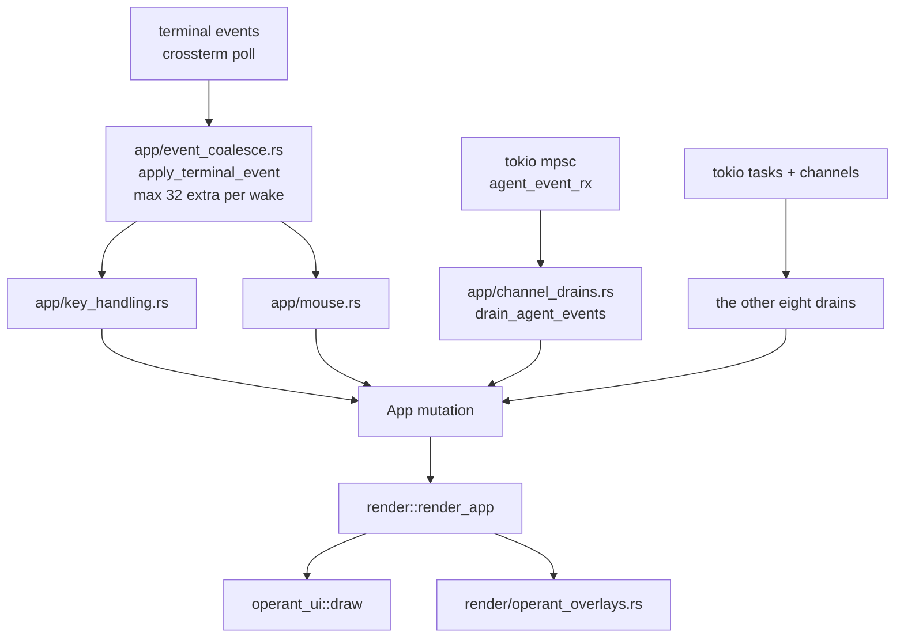

# The TUI — one renderer, one frame assembler, one state machine

Owns: the terminal interface's architecture — the module layering, the
transcript flatten layer and its invariants, the event loop and the
drains, the composer, the slash-command registry and its dispatch gate,
the overlay inventory, and the redraw cadence.

Not for: driving the TUI headlessly, the simulator flags and the golden
corpus ([tui-debugging.md](tui-debugging.md)), the agent that the TUI
frames (`[agent-loop.md](agent-loop.md)`), session storage and rewind
(`[sessions.md](sessions.md)`), how a row of text becomes cells
(`[tui-rendering.md](tui-rendering.md)`).

Source: `crates/operant-cli/src/tui/mod.rs` (the module map — 351 files, 177,708 Rust lines at commit `a80d65bc`), `crates/operant-cli/src/tui/app/`
(event loop and `App` state), `crates/operant-cli/src/tui/operant_model/`
(the transcript data model and the one flatten adapter),
`crates/operant-cli/src/tui/operant_ui/` (frame assembly, 34 top-level
files), `crates/operant-cli/src/tui/render/` (the per-frame entry and the
overlay paint ladder), `crates/operant-cli/src/tui/prompt_input/` (the
composer), `crates/operant-cli/src/tui/overlays/` +
`crates/operant-cli/src/tui/dialogs/`, `crates/operant-cli/src/commands.rs`
(the shared `CommandRegistry`), and the TUI command table in
`crates/operant-cli/src/tui/operant_app/app.rs` (`REGISTERED_COMMANDS`).

## Contents

- [What the TUI is, and what it is not](#what-the-tui-is-and-what-it-is-not)
- [The layering (seven planes)](#the-layering-seven-planes)
- [The central invariant: one flatten, one assembly, one section](#the-central-invariant-one-flatten-one-assembly-one-section)
- [Event flow](#event-flow)
- [The overlay inventory](#the-overlay-inventory)
- [The composer](#the-composer)
- [Keys, and the command registry](#keys-and-the-command-registry)
- [Scroll, and the prompt-jump chords](#scroll-and-the-prompt-jump-chords)
- [Redraw cadence](#redraw-cadence)
- [Configuration](#configuration)
- [Surfaces](#surfaces)
- [Failure modes](#failure-modes)
- [Intention](#intention)

## What the TUI is, and what it is not

The TUI is a terminal client for the agent, built on `ratatui` 0.30 and
`crossterm` 0.29. It owns nothing the agent owns: it does not run the model,
does not hold a database handle for long, and does not decide what a tool
does. It turns `AgentEvent`s into a transcript, turns keystrokes into
prompts and commands, and paints the result.

Three structural facts about the code precede any detail:

- The visual layer is a **port of jcode** (MIT, (c) 2025 Jeremy Huang),
  vendored @ `0a9dc7805` under `tui/vendor/`, `tui/operant_ui/`,
  `tui/operant_model/`, `tui/operant_markdown/`, `tui/operant_render*/`,
  `tui/operant_mermaid/`, `tui/operant_anim/` and
  `tui/operant_app/`. Every one of those files carries a `// Vendored
  from ...` header naming the upstream path, and `tui/operant_ui/mod.rs`
  carries a `[port-excision]` block listing every upstream child that was
  deliberately NOT ported, with the reason. Treat those blocks as the
  authority on what is absent; a missing render path is usually a
  documented excision, not a bug.
- The port is **partial by design**. `tui/operant_app/mod.rs` states the
  rule: the App struct and every App-bound function are never ported.
  Operant's own `App` (`tui/app/mod.rs`, 220+ fields) is adapted onto the
  ported types. That is why the ported renderers take `&dyn TuiState`
  (`tui/operant_app/tui_state.rs`, ~145 declared methods) and never `&App`.
- The only **deliberate adaptation point** in the whole visual port is
  `display_messages()` in `tui/operant_model/adapter.rs`. Everything else
  in `operant_model` is a verbatim port.

## The layering (seven planes)

| Plane | Directory | Files | Role |
|---|---|---|---|
| **App** | `tui/app/` | 29 | the event loop, `App` state, drains, key/mouse routing, slash dispatch, scroll state |
| **Model** | `tui/operant_model/` | 11 | `DisplayMessage`, `PreparedChatFrame`, and `adapter.rs` — operant transcript → jcode message model |
| **UI assembly** | `tui/operant_ui/` | 38 + 12 in subdirs | ONE frame assembler: `ui_prepare.rs` builds, `ui_viewport.rs` paints, `draw()` in `mod.rs` owns the frame |
| **Render core** | `tui/operant_render_core/`, `tui/operant_render/`, `tui/operant_markdown/`, `tui/operant_mermaid/`, `tui/operant_anim/`, `tui/vendor/style/` | 8 + 5 + 11 + 10 + 1 + 7 | backend-neutral document model, chrome, markdown, mermaid engine, idle-animation kernels, theme palettes |
| **App-core leaf** | `tui/operant_app/` | 54 | the renderer-facing slice of jcode's app core (config shim, perf policy, info widgets, side panel, logging) |
| **Surfaces** | `tui/overlays/`, `tui/dialogs/`, `tui/stats_dialog/`, `tui/session_hub/`, `tui/settings_screen/`, `tui/diff_viewer/`, `tui/agents_view.rs`, `tui/mcp_view.rs`, … | 6 + 3 + 4 + 4 + 4 + 4 + 1 each | every panel a slash command opens |
| **Composer** | `tui/prompt_input/` | 16 (15 modules + `prediction/`) | the prompt editor: word classes, `@` grammar, ghost text, vim |

`crates/operant-cli/src/tui/mod.rs` is the map: it declares every one of
these modules and carries the `#[expect(dead_code)]` gates that keep the
porting state honest. Read it before adding a module.

## The central invariant: one flatten, one assembly, one section

Four claims in `AGENTS.md` describe this, and each is verifiable in the
code. Verified against commit `a80d65bc`:

1. **One flatten layer.** `display_messages(app: &App) -> Vec<DisplayMessage>`
   (`tui/operant_model/adapter.rs:73`) is the only function that converts
   operant transcript state into display rows. The whole renderer consumes
   its output. Its own header table names every operant state and what it
   maps to.
2. **One frame assembler.** `prepare_messages()` in
   `tui/operant_ui/ui_prepare.rs:741` is the entry; the actual build is
   `prepare_messages_inner()`, which returns a `PreparedChatFrame` whose
   sections are assembled at one call site
   (`ui_prepare.rs:1094`, `PreparedChatFrame::from_sections`). The
   section list is exactly `Header`, `Body`, `InlineImages`,
   `BatchProgress`, `Reasoning`, `Streaming` — in that order.
3. **Every row renders in exactly one section.** The Body section comes
   from `display_messages()`, which skips a reserved tool row while the
   tails stream (`adapter.rs:88`); the Streaming section is built only
   when `has_streaming` (`ui_prepare.rs:942`) and contains the live
   thinking/text plus `live_tool_rows()` (`adapter.rs:214`). The two
   sections are disjoint by construction.
4. **Tool rows anchor by arrival.** A `ToolUseBlock` carries
   `after_index` — `App::messages.len()` at the moment the call started
   (`tui/app/enums.rs:218`) — and `display_messages` splices each row
   after message `after_index - 1` and before `after_index`
   (`adapter.rs:99-106`). A call that ran between two assistant messages
   renders between them. This is the iter-668 fix for "tool calls after
   the final answer".

**What "reserved" means, precisely.** `is_reserved(app, block)` is
`block.after_index > app.messages.len()` (`adapter.rs:242`). While the
tails stream, `tails_live(app)` is true (`adapter.rs:238`:
`is_streaming && (!streaming_thinking.is_empty() || !streaming_text.is_empty())`),
so a reserved row is skipped from the Body and rendered in the Streaming
section. Once the boundary flush commits the tails, `after_index <=
messages.len()` and the row returns to the Body at its anchor. There is
no flush at `ToolStart`.

**Why the rule exists.** A row that renders in both sections double-paints
at two wrap widths — the "shredded fragments" family (iters 784/789 in
`AGENTS.md`'s history). The regression oracles for it are the
`ui_prepare/tests.rs` duplicate-row tests and the corpus scenarios
`identical-tool-rows` and `tool-split-stream`.

**The runtime half.** `App::display_messages()` is a cache, not a
re-flatten per frame: `tui/app/tui_state_impl.rs:103`
(`display_messages_slice`) keeps a leaked buffer keyed on
`transcript_version`. Every mutation that changes the transcript must bump
that cell; `invalidate_transcript()` is the one entry point. A renderer
that reads the slice across a mutation is a bug the code comments call out
explicitly.

## Event flow

In order:

1. **A wake.** `App::run` (`tui/app/mod.rs:1919`) polls the terminal and
   applies one event through `App::apply_terminal_event`
   (`tui/app/event_coalesce.rs`), then drains up to
   `MAX_DRAINED_EVENTS_PER_WAKE` (32) more already-buffered events through
   the same path. Coalescing changes *when* state is painted, never
   *what*: the events are handled in arrival order by the same code, and
   the frame after them renders the result. Simulated runs never coalesce.
2. **The drains.** Between wakes, every frame runs the background-channel
   drains in a **load-bearing order** documented at the top of
   `tui/app/channel_drains.rs`: session list, model fetch, user questions,
   mcp reconnect, `agent_events`, `permission_requests`, `run_complete`.
   The ordering note in that header explains each adjacency — the pair
   that matters most is `agent_events` before `run_complete`, because both
   are produced by the same task and reversing them drops the last
   content delta into an already-idle footer.
3. **`agent_event_rx`.** `TuiApp::run` creates one
   `tokio::sync::mpsc::channel::<AgentEvent>(256)` and stores the
   receiver on `App.agent_event_rx` (`tui/adapter_types/tui_app.rs:155`).
   In attach mode the socket reader forwards `WireMessage::Event`s into
   the SAME sender, so the render layer cannot tell a local agent from a
   server across the session socket.
4. **`drain_agent_events`** (`channel_drains.rs:416`) does `try_recv`
   until empty, then calls `handle_agent_event` per event
   (`tui/app/agent_events.rs`). In the headless simulator with
   `--frame-per-event` it applies exactly one event per loop pass, which
   is what makes mid-stream frames capturable.
5. **The frame.** `render::render_app` (`tui/render/mod.rs:49`) first
   touches the stall watchdog (`logging::watchdog::frame`), then hands the
   whole frame to `crate::tui::operant_ui::draw(frame, app)`
   (`tui/operant_ui/mod.rs:2476`) — the ported jcode chrome, which owns
   the full-frame clear, every band, and the buffer-level colour
   substitution at its tail. `render_app` then republishes the hit-test
   cells the ported layout does not know about (`last_selectable_area`,
   `last_input_area`, `last_render_scroll_offset`,
   `last_render_content_pos`, `last_msg_area` — all `Cell`s on `App`),
   paints the background-task rows, paints every operant-only overlay via
   `draw_operant_overlays` (`tui/render/operant_overlays.rs:624`), and
   finishes with the OSC 8 hyperlink pass.

The `TuiState` trait (`tui/operant_app/tui_state.rs`) is the seam the
ported chrome reads; `tui/app/tui_state_impl.rs` is the only implementor
in production. When the chrome needs something the trait does not carry,
the port convention is to extend the trait, not to reach for `App`.

## The overlay inventory

There are two independent lists, and both are real:

- **`App::overlay_flags()`** (`tui/app/commands.rs:93`) — 29 entries,
  `(snapshot_key, is_visible)`. It is the single source of truth for the
  simulator's `overlays.*` assertions and for `any_modal_open()`, and a
  unit test (`test_overlay_flags_matches_debug_snapshot_keys`) plus
  `dialog_covers_every_gated_surface` (`tui/app/dialog_routing.rs`)
  derive their tables from it. Note two non-modal surfaces deliberately
  kept OUT of it — `usage_overlay` and the F12 `debug_overlay` — because
  folding them in would make `any_modal_open` claim a modal is up when
  none is.
- **The paint ladder** `OVERLAYS` in `tui/render/operant_overlays.rs:213`
  — 31 rows, in z-order, each naming its visibility predicate, its
  delegation to the surface's own module, and its sink (`Frame` or
  `Buffer`). The table is pinned by
  `dispatch_rows_are_the_registered_surfaces_in_paint_order` against a
  hand-written `EXPECTED` slice: a row added, dropped, renamed or moved
  fails the test, because the order IS the behaviour (later rows win the
  cells they share with earlier ones).

The catalogue and the ladder are not the same set by construction: the
ladder also carries `permission_dialog`, `selection_highlight`,
`selection_row_cache`, `context_menu` and `debug_overlay`, which are not
App overlay flags.

The surfaces a command opens, grouped by what they are for:

- **Transcript-side panels**: `/skills` (skills_view), `/plugins`
  (plugins_hub), `/journey` (journey_view), `/mcp` (mcp_view), `/agents`
  and `/tasks` (agents_menu), `/diff` `/review` `/changes` (diff_viewer),
  `/search` `/find` (global_search), `/stats` `/cost` (stats_dialog),
  `/context` (context_viz).
- **Session surfaces**: `/resume` `/sessions` `/session` (session_hub),
  `/branch` (session_hub on the branch filter), `/rewind` and `/undo`
  (rewind_selector), `/export` `/save` (export_dialog).
- **Settings and appearance**: `/config` (settings_screen),
  `/theme` `/skin` (theme_screen), `/keys` and `/hotkeys` (the help
  overlay in `Keys`/`Hotkeys` content mode), `/help` (help overlay).
- **Provider connection**: `/connect`, `/login` `/init`, plus the
  `import_config_picker` / `import_config_dialog` pair.
- **Permission and questions**: the permission dialog
  (`tui/dialogs/permission.rs`), the bypass-permissions confirmation, the
  permissions picker, and the ask-user dialog.
- **Composer chrome**: the command palette, the Ctrl+R history-search
  overlay, the inline interactive picker (the model/effort picker since
  plan 05B).

`tui/overlays/` itself holds only the three floating overlays
(`global_search.rs`, `help.rs`, `history_search.rs`) plus
`layout.rs`, which is the shared modal-geometry module
(`modal_frame`, `modal_frame_buf`, `ModalSpec`, `render_dialog_bg`) every
other surface builds on. Everything else named above lives in its own
top-level file or directory.

### The dialog leaves, named

Every dialog the inventory above names is its own top-level file, and a
reader arrives at each one from the surface that opens it. They are listed
here by stem so the family has ONE owner: `bypass_permissions_dialog.rs`
(the `--dangerously-skip-permissions` startup confirmation),
`custom_provider_dialog.rs` (a base URL plus an API key for a custom
OpenAI-compatible upstream), `free_mode_dialog.rs` (the composite "Free"
provider's caveats, collecting keys for any subset of Cohere / OpenRouter /
OpenCode Zen / Z.AI / Zhipu), `key_input_dialog.rs` (the masked
API-key text overlay), `dialog_select.rs` (the reusable fuzzy-search
selection widget the `/connect` picker uses), `permissions_picker.rs`
(the `/permissions` mode picker) and `memory_file_selector.rs` (the
MEMORY.md / USER.md picker).

### The top-level leaf modules

The files directly under `tui/` that are not a plane of their own are each
one narrow concern; the layering table above says which plane owns them, and
this is the stem list a reader needs to find one:

- **Chrome and icons**: `figures.rs` (the icon constants),
  `banner.rs` (the OPERANT ASCII wordmark in three sizes, above the
  welcome panel), `space.rs` (the TUI's spacing ladder in cells — one
  doubling scale, `XXS * 2 == XS` up to `XL`, that every modal-sizing call
  site reads instead of re-typing `-2` / `-4`) and
  `rustle.rs` (the welcome box's ambient blink lines). Its header names a
  caller in the render layer that does not exist anywhere in the tree — no
  non-test call site remains, so read it as an unreferenced ported leaf.
  The App fields and `tick_rustle_pose()` were deleted in iter-144 (the
  pose argument is ignored); the `/pet` trigger went with them.
- **Model choice**: `model_selector.rs` (one grammar for "which model, in
  which role, at what effort") and `model_effort.rs` (the
  low/normal/high/max ladder and its one wire spelling).
- **Terminal capability**: `keyboard_enhancement.rs` (the Kitty
  keyboard-protocol enablement that makes Shift+Enter arrive),
  `terminal_setup.rs` (the `/terminal-setup` help that tells the operator
  how), `image_render.rs` (Kitty / Sixel / iTerm2 inline images),
  `image_paste.rs` (clipboard image detection and text paste via
  platform CLI tools, no native bindings) and `clipboard.rs` (the single
  owner of every clipboard WRITE — a preference-ordered chain of arboard,
  wl-copy, xclip, xsel and an OSC 52 tty escape, so a copy either goes
  through it or does not happen at all).
- **Input and search**: `input.rs` (the slash-command predicate and
  parser — `is_slash_command` / `parse_slash_command`, the pair every
  submit path asks "is this a command?" with), `input_history.rs` (the
  persistent submitted-prompt log at `<home>/history.jsonl`, which is what
  makes up/down cycle across sessions and what the ghost engine bootstraps
  from), `external_editor.rs` (Ctrl+G: composer text → temp file → the
  resolved `$VISUAL`/`$EDITOR`/`vi` on the suspended terminal → composer
  text), `fold_search.rs` (case-insensitive search that
  cannot panic on fold-length drift — BUGS.md R48-3) and
  `slash_usage.rs` (recent-usage tracking that orders `/` suggestions).
- **Notices**: `notifications.rs` (the `NotificationKind` taxonomy the
  composer's notices are routed by — transient kinds to the 3 s status
  line, `Error` to a persistent inline transcript card).
- **Live rows and marks**: `background_tasks.rs` (persistent rows for
  work that must outlive the turn), `rewind_marks.rs` (the rewind
  selector's live mark source), `session_switch.rs` (the hub's
  Enter → session-switch handle) and `pinned_images.rs` (the registry of
  terminal graphics placed outside ratatui's cell grid, repainted after
  every draw so a Kitty/Sixel/iTerm2 image survives the flush that used to
  erase it).
- **Surfaces opened by a command**: `ask_user_dialog.rs` (the
  model-initiated `AskUserQuestion` overlay — question, numbered choices,
  free-text line), `context_viz.rs` (the `/context` window + rate-limit
  bars), `diff_viewer.rs` + `diff_viewer/parse.rs` (the `/diff` two-pane
  file list + unified diff, and the `git diff HEAD` / `parse_unified_diff`
  pair that feeds it), `export_dialog.rs` (the `/export` JSON-vs-Markdown
  format picker), `import_config_dialog.rs` (the import preview and
  selection overlay), `journey_view.rs` (the `/journey` skills + memories
  timeline), `plugins_hub.rs` (the `/plugins` browser and
  enable/disable toggle), `rewind_selector.rs` (the fullscreen `/rewind`
  transcript selector), `settings_screen.rs` + `settings_screen/keys.rs` +
  `settings_screen/tabs.rs` (the `/config` searchable settings panel, its
  key routing and edit helpers, and the prefix-derived tab/heading
  classification that stops a flat list of 385 registry rows),
  `skills_view.rs` (the `/skills` browser with SKILL.md inspect),
  `stats_dialog.rs` (the `/stats` four-tab overlay), `theme_screen.rs`
  (the `/theme` picker with colour swatches) and `usage_overlay.rs` (the
  always-on session cost / cache / token panel).
- **Keybinding catalogue**: `keybindings/registry.rs` — the
  `KeyBindingRegistry` construction, registration, context-fallback
  lookup, matching and removal, split out of the `keybindings.rs`
  monolith.

`tui/messages/markdown_enhanced.rs` is a 7-line comment-only stub: its
doc header describes the table renderer it once held, and the module now
contains no items at all — tables are rendered by
`render_table_aligned` in `operant_markdown/markdown_render_support.rs:223`.
Read the header as history, not as a call target. `tui/substitution_cost.rs`
is a `#[cfg(test)]`, `#[ignore]`d characterisation of the per-frame
colour-substitution pass (deliverable 1.10 of `docs/PLAN-TUI-OVERHAUL.md`)
and costs nothing in a release build.

### The `app/` leaves

`tui/app/` is the event loop, and the files below are the ones that are not
the loop itself. Four of them are `impl App` method families split out of
the former `app/mod.rs` monolith, named here by what their methods do rather
than by what they are called: `messaging.rs` (messages and notices —
`add_message`, `push_notice`, `check_token_warnings`, `invalidate_transcript`,
`take_input`), `prompt.rs` (the composer's state — `set_prompt_text`,
`refresh_prompt_input`, the input stash, `run_external_editor`, the
file-suggest spawn), `providers.rs` (provider and model management —
`set_model`, `apply_theme`, `cycle_configured_model`, the inline model and
effort pickers) and `turn_state.rs` (the `TurnState` lifecycle and the
per-turn metadata sync — `begin_turn`, the agent-mode snapshots, the rewind
flow entry, onboarding persistence).

`herdr_lifecycle.rs` is the Herdr editor-pane lifecycle
bridge; `session_display.rs` is the ONE converter from a core conversation
to the TUI's display state (both rebuild paths call it rather than each
carrying its own lossy copy). The rest are the split-out contract tests —
one file per contract, split out of the former monolith `tests.rs` so each
has its own home: `advisor_card_tests.rs` (the advisor card the operator
reads), `debug_log_tests.rs` (the debug log sees the surfaces that own the
keyboard), `notice_ttl_tests.rs` (transient notices must LEAVE),
`session_counter_tests.rs` (per-session counters and the context overlay's
live window occupancy), `session_display_tests.rs` (a restored transcript
keeps the turn's ACTIVITY) and `steer_queue_tests.rs` (the steer queue the
operator can see).

### The `operant_app/` leaves

`tui/operant_app/` is the vendored jcode app-core slice (54 files). The
files below are each one narrow concern that a reader reaches through this
page's family description:

- **Ambient and build**: `ambient.rs` (ambient runner/queue, partial port),
  `build_meta.rs` (build version and channel metadata),
  `color_support.rs` (terminal color-depth detection),
  `theme_detect.rs` (terminal theme detection, degraded arm).
- **Session and layout**: `layout_utils.rs` (section-height helpers),
  `session_facts.rs` (centralized session facts formatting),
  `side_panel.rs` (side panel types).
- **Rendering helpers**: `tui_fns.rs` (the `TuiState` trait surface the
  ported chrome reads), `mermaid_inline.rs` (inline mermaid rendering),
  `process_memory.rs` (process-memory history types).
- **Scheduler and catalog**: `catalog_scheduler.rs` (provider catalog
  scheduling), `fuzzy_engine.rs` (the fuzzy-match engine),
  `fuzzy.rs` (the thin typo-tolerant adapter slash-command matching
  calls through to it), `graph_topology.rs` (memory-graph topology helpers),
  `helpers/model_names.rs` (human-friendly model names),
  `helpers/git.rs` (the git-probe family — `gather_git_info`,
  `parse_recent_commits`, `parse_numstat`, `porcelain_status_letter` — that
  the info-widget tests reach through `operant_app::app::helpers`),
  `provider_metadata/catalog.rs` (the `OPENAI_COMPAT_PROFILES` and
  `LOGIN_PROVIDERS` tables the `/connect` surfaces read).
- **Ported type leaves**: `build.rs` (build-progress path, cache and TTL,
  `read_build_progress`), `bus.rs` (the batch sub-call progress types plus
  `BusEvent` / `Bus` / `latest_update_status`), `compaction.rs`
  (`CHARS_PER_TOKEN` and the one best-effort context-size heuristic that
  reconciles split vs subset provider token accounting), `core.rs`
  (char/byte boundary helpers and `DisplayMessageRoleExt::effective_role`,
  which recovers a lost `background_task` role from the notification's
  shape), `id.rs` (`SESSION_NAMES` and `session_icon`), `keybind.rs` (the
  platform Alt/Option label helpers), `plan.rs` (`PlanItem`, the
  server-shared swarm plan item), `prompt.rs` (the swarm effort consts and
  `ContextInfo`), `protocol.rs` (the ported slice of operant-protocol),
  `session.rs` (`RenderedImage` / `RenderedImageAnchor` and the
  attached-image label parsers), `storage.rs` (a declared port-excision
  leaf: operant-storage's state dirs, secrets and env files are not
  ported), `todo.rs` (the todo/feedback type family — the
  `semantic_state!` macro with its ten invocations, `TodoItem` /
  `TodoPlan` / `TodoGoal` and the pass predicates), `usage.rs`
  (`OpenAIUsageWindow` / `OpenAIUsageData` / `OpenAiResetCredits` plus the
  staleness consts), `util.rs` (token-estimation helpers —
  `estimate_tokens`, `format_approx_token_count`, `ApproxTokenSeverity`)
  and `usage_overlay.rs` (the ported usage-overlay TYPES —
  `UsageOverlayStatus` and friends; the live panel that renders them is
  `tui/usage_overlay.rs`, cited above).
- **Environment, logging and permissions**: `env.rs` (the centralized
  `set_var` / `remove_var` wrappers over `std::env`, so the unsafe of
  Rust 2024 env mutation lives in one auditable place), `logging.rs`
  (the log writer for `<home>/logs/` with rotation and thread-local
  server/session/provider context), `logging/watchdog.rs` (the stall
  watchdog: `beat` / `begin_work` / `is_busy` / `resource_snapshot`, plus
  the operant-local `frame()` and `start_monitor()` halves the TUI wires),
  `permissions.rs` (the permission-mode types the overlay reads),
  `safety.rs` (the file-backed permission-decision surface —
  `PermissionRequest` / `PermissionResult` / `Decision` and
  `record_permission_via_file`), `keyboard.rs` (the kitty/tmux
  keyboard-enhancement request/reset block and `reapply_terminal_modes_to`)
  and `mermaid.rs` (the W9 cfg-fallback: `is_mermaid_lang`,
  `RenderResult`, `result_to_lines` and the placeholder parsers).
- **The markdown re-export facade**: `markdown.rs` re-exports the
  `operant_markdown` entry points under the vendored path the ported
  renderers import (`render_markdown`, `render_markdown_with_width`,
  `highlight_line`, `center_code_blocks`, …). A symbol missing from that
  list is a `[port-unresolved]` excision, not an oversight.
- **Info widgets** (`tui/operant_app/info_widget/`): `info_widget_frame.rs`
  (border chrome), `info_widget_layout.rs` and
  `info_widget_layout_tests.rs` (widget placement), `info_widget_overview.rs`
  (overview widget with model + context% + git branch),
  `info_widget_commits.rs` (recent commits widget),
  `info_widget_git.rs` (git status detail layer),
  `info_widget_model.rs` (model identity detail layer),
  `info_widget_memory_render.rs` and `info_widget_memory_utils.rs`
  (memory-count rendering and utilities),
  `info_widget_todos.rs` (todo pips widget),
  `info_widget_usage.rs` (usage-limits widget),
  `info_widget_diagram.rs` (mermaid diagram widget),
  `info_widget_graph.rs` (memory-graph re-export),
  `info_widget_settle.rs` and `info_widget_settle_tests.rs` (negative-space
  settlement tracking), `info_widget_stability.rs` and
  `info_widget_stability_tests.rs` (movement quantification),
  `info_widget_swarm_background.rs` and `info_widget_swarm_gallery.rs`
  (swarm status widgets), `info_widget_tips.rs` (tips widget),
  `info_widget_text.rs` (text utilities), `info_widget_timeline.rs` (ported
  but not declared in `mod.rs`), `info_widget_tests.rs` (the test module).
- **Overnight and visual debug**: `overnight.rs` (overnight-task types,
  partial port), `visual_debug.rs` (frame-capture types and builder).

### The `vendor/style/` leaves

`tui/vendor/style/palette_literals.rs` is the literal color-role list
upstream's `Role` enum maps into.

### The composer leaves

`tui/prompt_input/prediction/dictionary.rs` is the seed dictionary — the
predictor's cold-start vocabulary. The learned n-gram (plan 2026-10-24 M5)
only knows the words the operator has submitted; this is the fallback that
makes word-completion work before any history exists.

## The composer

`tui/prompt_input/` was decomposed from a 5,305-line monolith into
focused submodules. The state lives in `state.rs`
(`PromptInputState`, `InputMode`); the editor ops are in `editing.rs`,
`history.rs`, `paste.rs`, `kill_ring.rs` (Emacs kill ring),
`visual.rs`, `suggestions.rs`, and the vim layer in `vim.rs`,
`vim_command.rs`, `vim_ops.rs`.

Three OMP-derived surfaces carry their own rules:

- **Word classes** (`word_nav.rs`). `classify()` puts a char in one of
  four classes — `Whitespace`, `Word`, `Delimiter`, `Cjk` — and a word
  stop consumes a *run* of one class, so `->` is one stop and a CJK run
  is one stop. Joiners (`'`, `’`, `-`, `‐`, `-`) stay inside a word when
  a word char sits on both sides, so `don't` and `well-known` move as one
  stop. `vim.rs`'s own `w`/`b`/`e` motions keep vim's rules deliberately
  and do not use this module.
- **The `@` grammar** (`typeahead.rs`). `parse_file_ref_token` finds the
  last `@` at a word boundary, accepts `@`, `@file:` and `@folder:`, and
  terminates the token exactly where the agent-side expander's grammar
  terminates it (`context_references::REFERENCE_PATTERN`: bare values end
  at whitespace, quoted values at the closing quote). Accepting a FILE
  inserts `@file:<path>` plus a trailing space; accepting a DIRECTORY
  inserts `@folder:<path>/` with NO trailing space, so the popup chains
  into the drilled directory. Paths with spaces quote the value, and a
  quoted directory stays open until a file inside it closes it.
  `file_ref_value` normalises so the separator is never doubled (the
  2026-10-27 fix for the on-screen and round-trip `@folder:crates//`).
  A `$skill` mention is a third tier, and it extends the buffer rather
  than submitting it.
- **Ghost text** (`ghost.rs` + `prediction/`). `ghost_query()` is the
  prose gate: it returns `None` while the suggestion popup is open, inside
  an `@` reference, inside a `$skill` mention, in a slash-command input,
  inside an odd number of backticks, or mid-word. When it does return,
  the word at the caret is completed by an in-process interpolated
  trigram engine on a dedicated OS thread (`prediction/model.rs`,
  `prediction/query.rs`, `prediction/mod.rs`). The engine bootstraps from
  `input_history::load()` when no snapshot exists, learns from every
  submitted prompt, and persists atomically to
  `<operant_home>/predict/ngram.snapshot` (`prediction/snapshot.rs`).
  TAB accepts with a trailing space, → accepts verbatim, any divergence
  drops the ghost.

File discovery for the popup is a third module family:
`tui/file_discovery/walker.rs` is a cached gitignore-aware walk (no
persistent index — the TTL cache IS the index), and `score.rs` is the
OMP two-tier scorer (exact/prefix/includes/subsequence, filename before
path, `+10` for directories, shallower paths win ties, top-K in a
worst-first heap).

## Keys, and the command registry

There are two distinct things, and neither substitutes for the other.

**The dispatcher** is `App::handle_key_event`
(`tui/app/key_handling.rs`, ~3,557 lines). It is a hand-written
if-chain in a deliberate order: the inline picker first (so it cannot eat
its letters as composer text), then every visible modal surface, then
composer keys, then scroll keys. `tui/app/dialog_routing.rs` holds the
priority chain that decides which modal owns the keyboard, and the
`dialog_covers_every_gated_surface` test derives that chain from
`overlay_flags()` so a surface cannot be added to the catalogue without a
gate.

**The keybinding catalogue** is `tui/keybindings.rs` +
`keybindings/defaults.rs`. It is NOT the dispatcher — its own header says
so — it is the source of truth for *what the bindings are*, read by
`/keys` and `/hotkeys` and matched against every accepted key event by
`App::record_keybinding_usage` (`key_handling.rs:2643`) to count usage
into the shared `UsageStore`. The registry ships defaults only; the
`load_keybindings_from_config` / `save_keybindings_to_config` pair was
deleted as a no-op stub, and `[keybindings]` in the TOML is parsed and
ignored (`crates/operant-core/src/config.rs:33`).

**The slash-command registry** is the table
`REGISTERED_COMMANDS` in `tui/operant_app/app.rs` — 113 rows: 105 public,
6 hidden, 2 remote-only (one public row, `/effort`, is duplicated behind
`#[cfg(any())]`, so 111 unique live names as of `a80d65bc`). Each row is
`name`, `help`, `hidden`, `remote_only`. Every consumer reads this one
table: the typeahead and command palette
(`locally_suggested_command_rows`, remote-only excluded so the popup
never offers a command that cannot run here), the `/help` overlay
(`registered_command_rows` / `locally_visible_command_rows`), the
no-unwired guard, and the gateway's shared registry.

Dispatch is `App::handle_tui_command(cmd, args)` →
`intercept_slash_command_with_args_impl` (`tui/app/commands.rs:502`). The
match arms are the TUI-only commands (opening a panel, flipping a toggle,
queueing a prompt); anything without an arm falls to the `_` arm, which
tries `self.command_registry.resolve(cmd)` — the shared
`crates/operant-cli/src/commands.rs` registry, whose handlers return a
`CommandResult` (today only `Message` and `ShellCommand`) — and then,
failing that, a vendor skill of the same name.

**The invariant that a registered command can never fall through to the
model.** It has two halves, both in `tui/adapter_types/tui_app.rs` (the
interactive loop at ~:819 and the simulator loop at ~:1576, which mirror
each other on purpose):

1. If `handle_tui_command` returns `true`, the input is a command and no
   turn starts.
2. If the TUI did not intercept it but the shared registry resolves it,
   the registry handler runs and no turn starts.
3. Otherwise, if the name is in
   `registered_command_names_including_hidden()`, the TUI prints
   `"/<cmd> is registered but not wired in operant yet — see /help for
   working commands"` and continues. Hidden aliases are included here on
   purpose (iter-790): the autocomplete advertises them, so submitting one
   must not become prompt text.

Truly unknown `/…` text still falls through to the model as a prompt.
The static guard is
`tui/app/tests.rs::no_registered_tui_command_is_unwired`, which drives the
real dispatch for every locally dispatchable name under a multi-thread
runtime and asserts both that interception happened and that no
"not yet wired to a handler" annotation appeared. A second loop does the
same for every row the typeahead offers, vendor skills included.

**Mid-stream.** Plain Enter dispatches a REGISTERED command while a turn
streams (iter-1402): each arm guards itself (`/clear` cancels and defers
to the drain, `/stop` triggers the real interrupt, `/undo` refuses
honestly, display toggles flip state). Unregistered `/…` text still
waits for idle. The test pair
`registered_command_with_args_submits_while_streaming` /
`unregistered_slash_text_still_waits_while_streaming` pins both sides.

## Scroll, and the prompt-jump chords

`App` owns scroll as plain state (`scroll_offset`, `auto_scroll`,
`scroll_memory`), and `tui/app/scroll_anchor.rs` is the state machine.
Two invariants are worth knowing before touching it:

- **Row indices come from the frame the renderer last drew**, never from
  a second copy. `prompt_row_starts()` reads
  `operant_ui::last_chat_frame()` → `PreparedChatFrame::wrapped_user_prompt_starts`
  (`scroll_anchor.rs:221`). An earlier design kept a live mirror and the
  mirror could disagree with the paint.
- **A resize is resolved in content coordinates.** `note_resize()`
  captures `App.last_render_content_pos` (published by the chrome each
  frame), and the next paint resolves it against the new wrap via
  `resolve_content_pos`. A `pending_resize` anchor is re-pinned on the
  next paint, so both prompt-jump functions consume it — otherwise a jump
  snaps straight back to where the reader started.

The chords, all in `tui/app/key_handling.rs`:

| Chord | Action |
|---|---|
| PageUp / PageDown | one page (`scroll_page_step()`) |
| Ctrl+Up / Ctrl+Down | 3 rows |
| Alt+Up / Alt+Down | 20 rows |
| Shift+Home / Shift+End | top of transcript / back to the tail |
| Alt+G | scroll bookmark (first press remembers, second jumps back) |
| Ctrl+G | open the prompt in `$EDITOR` |
| Alt+[ / Alt+] | previous / next user prompt |

`Ctrl+[` and `Ctrl+]` are also dispatched as aliases, because under the
kitty keyboard protocol `Ctrl+[` is reported as `Esc+CONTROL`; the help
overlay advertises the Alt chords because they work in every reporting
mode. Three always-live `KeyCode::Esc` arms (cancel, double-Esc,
transcript-focus) are all gated on `KeyModifiers::NONE` so they cannot
swallow the `Esc+CONTROL` spelling; modal Esc arms are correctly ungated.

`crates/operant-cli/src/tui/app/scroll_emit.rs` is the other half of
native scrollback: in terminal-scroll mode only, it emits settled rows
into the terminal's history via `Terminal::insert_before`, with a
MESSAGE-index watermark (not a row index, so a tool row re-rendering
between flushes cannot duplicate or shift history) and a replay on resize
that clears the old-width history rather than keeping it.

## Redraw cadence

`tui/redraw.rs` computes the poll interval from three axes:
`PerformanceTier` (Minimal / Normal / High), activity (streaming, idle,
deep idle), and focus. A backgrounded window drops to the slowest cadence
regardless of activity. The tier is auto-detected from
`OPERANT_PERF_TIER`, SSH/TTY presence, tmux, WSL, and `TERM_PROGRAM`.
The `reduce_motion` setting clamps the tier to Minimal and is the one
setting with a live effect on both the cadence and the animation policy
(`tui/operant_app/perf.rs` reads `redraw::reduce_motion()`).

The run loop draws unconditionally every pass; `App::redraw_reason()`
(`tui/app/redraw_reason.rs`) exists so the F12 overlay can answer "why was
this frame painted?" with a stable name rather than a bool. It is
diagnostic, not a gate.

## Configuration

The TUI reads two disjoint config surfaces, and knowing which is which
prevents most confusion.

**`[tui]` in `operant.toml`** — `TuiSettings`
(`crates/operant-core/src/config.rs:1343`). Live keys and defaults:

| Key | Default | What it actually changes |
|---|---|---|
| `theme` | `"default"` | one of `ColorPalette::NAMES` (`default`, `dark`, `light`, `solarized`, `nord`, `dracula`, `monokai`, `deuteranopia`). Anything else warns at startup and renders the default. |
| `colors` | `{}` | per-role `#rrggbb` overrides applied ON TOP of the theme (`[tui.colors]`). Unknown roles / non-hex values are skipped, not fatal. |
| `rich_output` | `true` | the master switch for entering the TUI at all; also routes logging. Forced off for the gateway daemon. |
| `terminal_scroll_mode` | `false` | inline viewport, no alternate screen, no mouse capture; the terminal's own scrollback owns history. |
| `show_tool_calls` | `true` | the initial value of the tool-row toggle (Alt+O flips it live). |
| `external_editor` | `""` | the Ctrl+G editor; empty means `$VISUAL`, then `$EDITOR`, then `vi`. |
| `double_escape_action` | `"rewind"` | what a double Esc on an empty composer does when not streaming (`rewind` or `none`). |
| `word_completion` | `"ngram"` | `"off"` disables the ghost engine. |
| `word_completion_threshold` | unset | overrides the engine's show threshold (τ 0.15). |
| `model_favorites` | `[]` | the picker's starred models (Ctrl+N). |
| `model_default` | unset | where a FRESH session's model lands; unset follows `[agent] model`. |

Accepted but **unread** (RT-136): `show_iterations`, `landing_title`,
`prompt_placeholder`, `refresh_rate_ms`, `compact_width`,
`medium_width`. They load and warn; the render layer consults none of
them. `[keybindings]` is likewise parsed and ignored (RT-3).

**`[agent] show_reasoning`** — `BehaviorSettings`
(`crates/operant-core/src/config.rs:716`, field at `:748`, default `true`). `main.rs`
bridges it into the TUI's config shim before any TUI launch: `true` →
`ReasoningDisplayMode::Current` (the turn's trace stays where it streamed
and hides once the next prompt lands), `false` → `Off`. `/thinking-display`
and Ctrl+T flip the same override cell live (`Full` is the third state and
is only reachable that way).

**Everything else the ported renderers read** comes from
`tui/operant_app/config_shim.rs` — a deliberate, documented shim whose
`DisplayConfig` is a snapshot of upstream defaults. Only the fields the
ported tree actually reads are wired through to real state:
`display.pin_todos` (`tui_state.rs` todo band), `display.mouse_capture`,
`display.redraw_fps` / `display.animation_fps` and
`display.copy_badge_alt_label` (perf policy and the copy badge),
`display.diagram_mode` (message cache), `display.show_agentgrep_output`,
`display.disabled_animations`. The rest of the struct exists so the
vendored renderers compile; a value set in TOML for a shim-only field
changes nothing, and the shim's header says which is which.

**`settings.json`** (`tui/adapter_types/config.rs::Settings`) is the
third surface: the settings screen (`/config`) writes it, and it holds
`theme`, `permission_mode`, `effort_level`, `vim_enabled`,
`reduce_motion`, `show_cwd`, `show_git_branch` and the `@`-autocomplete
pair. It is not TOML and it is not `[tui]`; a key that "does not stick"
is usually in the wrong one of the three.

## Surfaces

Slash commands: see the registry section above for the authority. Every
name this page mentions is in `REGISTERED_COMMANDS`.

Other operator-facing entry points:

- Bare `operant` (no subcommand) — the interactive client; it launches
  `TuiApp::enter(...).run()` when `tui.rich_output` is on
  (`crates/operant-cli/src/main.rs:3888`).
- `operant tui debug …` — the read-only inspection and headless
  simulator, documented in [tui-debugging.md](tui-debugging.md)
  (`cmd_tui_debug::TuiSubcommand::Debug`).
- `operant tui effort|mode|output-style|theme|vim|keybindings` — the
  state setters that keep TUI state and CLI state from drifting
  (`TuiSubcommand`, `cmd_tui_debug.rs:47`; a missing subcommand shows the
  current value, `set` changes it).
- `operant chat --attach <socket>` — attaches this same TUI to a running
  gateway's session socket (`tui/adapter_types/tui_app.rs`); the client
  builds no runtime, registry, database handle, MCP child or AFT bridge,
  and the events arrive on the same `agent_event_rx`.
- `operant chat` / `operant run` — the non-rich-output paths; when
  `tui.rich_output` is off or stdin/stdout is not a TTY, the CLI falls
  back to plain line I/O with a one-line stderr notice rather than
  failing on raw-mode setup.

## Failure modes

- **The draw panics.** `operant_ui::draw` wraps the frame in
  `catch_unwind`; a recovered panic leaves the partially-drawn buffer and
  logs one line (`"TUI draw recovered from panic: …"`). stderr is
  swallowed by raw mode, so that log line is the only symptom besides
  golden drift. `debug_capture` is compiled but inert (the upstream
  `ui_debug_capture.rs` was not ported), so there is no widget-level
  capture to fall back on.
- **A background task finishes while the TUI owns the screen.** The
  render path is the watchdog's liveness signal
  (`logging::watchdog::frame(is_streaming)`), and a freeze stops the
  frames. A drain that only ran on a keystroke would look like a hang; the
  drains run every frame, including tick frames with no input.
- **The cached transcript is stale.** `transcript_version` is the cache
  key. A mutation that forgets `invalidate_transcript()` renders the
  previous transcript until the next bump — silent, and the usual cause of
  "the TUI shows an old turn".
- **A per-frame prep cache miss is slow.** `prepare_messages` has a
  full-frame cache keyed on width/height/mode/version plus a body cache
  with prefix/suffix reuse. `OPERANT_DEBUG_PREP_ORACLE=1` makes every
  prepared frame also build uncached and compare, and the simulator fails
  on a non-zero mismatch counter — that is the duplicate-tool-rows class.
- **A modal eats a key.** Every modal owns the keyboard while visible
  (the inline picker first of all). A scenario that opens a modal and then
  types `/help` types into the modal, not the composer — see the
  host-dependent startup note in [tui-debugging.md](tui-debugging.md).
- **Mouse capture off.** Under `terminal_scroll_mode`, and under
  `--no-mouse`, the TUI never enables mouse capture: selection and
  scrollback belong to the terminal. A report of "the wheel does nothing"
  in those modes is the configuration, not a defect.

## Intention

The TUI is large because it is a port of a mature visual layer, and the
port is the reason it is shaped the way it is: one flatten
(`display_messages`), one assembly (`prepare_messages`), one paint ladder
(`OVERLAYS`), one state machine (`App`), one command table
(`REGISTERED_COMMANDS`). Each of those unifications replaced a drift class
that had already happened — a row rendering in two sections, a surface
painted by a deleted dispatch table, an overlay flag with no gate, a
command advertised but unwired. The `#[expect(dead_code)]` gates and the
`[port-excision]` blocks are the port's honest bookkeeping: they make an
unwired path loud rather than silent, which is the difference between a
vendored tree that can be finished and one that rots.

What it deliberately is not: a renderer reference (that is
[tui-rendering.md](tui-rendering.md)), a debugger manual
([tui-debugging.md](tui-debugging.md)), or a second source of truth about
sessions, memory, or the agent. When a TUI behaviour seems to contradict
one of those pages, the code wins and this page should be corrected.
